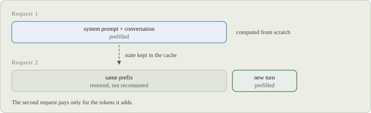

# Documentation

These rules apply to everything under `docs/`. They keep the documentation
short, consistent and readable by people and agents alike.

## Layout

| Path | Audience | Published |
| --- | --- | --- |
| `docs/*.md`, `docs/models/*.md` | People using or extending Gufo | Website, one copy per release |
| `docs/figures/` | Figures for public pages | Website, with the pages |
| `docs/internal/` | Contributors and agents working on Gufo | Repository only |
| `docs/internal/models/<model>/` | Implementation notes (`README.md`), benchmarks, quality and experiment evidence | Repository only |
| `docs/internal/server.md`, `docs/internal/cache.md` | Complete server and cache references behind the public pages | Repository only |
| `docs/internal/design/` | Design RFCs | Repository only |

A public page explains how to use something. An internal page explains how it
is built, measured or changed. When a page needs both, split it: the public
page links to the internal one.

Every public page starts with a `# Title` line, a blank line and a one- or
two-sentence summary; the website uses both for the page title and
description. [`README.md`](README.md) is the documentation home: it lists every
public page in reading order, and the website builds its navigation from it.
Model pages are listed in [`models/README.md`](models/README.md) instead.

## Style

Write like the [Gufo blog](https://gufo.blog/blog): plain, direct and exact.

- Address the reader as "you". Use the active voice. Contractions are fine.
- Prefer plain words to jargon. When a term is needed, put it in **bold** and
  define it the first time it appears on the page. Use one name for one concept
  across all pages.
- Lead with what the reader does or gets; follow with why only when the reader
  needs it to decide something.
- Give numbers exactly, with units, and date measurements: "As of November
  2026, ...". Link the evidence under `docs/internal/` instead of repeating it.
- Use tables only to compare things across the same columns. Use a numbered list
  only when order matters.
- Mark warnings (trust, exposure, data loss) with a blockquote starting with
  `**Warning:**`.
- Use plain Markdown that renders on GitHub: no MDX, HTML components or
  scripts. Code blocks name their language.

## Concision

Every sentence must earn its place; a reader should find the answer without
reading the whole page.

- One topic per page. One fact lives in one place; elsewhere, link to it.
- Budgets: 250 lines for a public page, 120 for a model page. Over budget means
  split the page or move detail to `docs/internal/`.
- Public pages hold current behavior only: no history ("used to", "now",
  "recently"), no PR or issue numbers, no design rationale. Rationale belongs in
  `docs/internal/design/`.
- Don't list every flag or field; show the ones a reader needs and point to
  `gufo <command> --help` for the rest.
- Cut filler: "simply", "just", "easily", "basically", "obviously", "note
  that", "it is worth", "seamless", "blazing".

## Keeping docs current

- A change in user-visible behavior updates the page that owns it in the same
  pull request.
- A new public page needs a maintainer's agreement; prefer extending an
  existing page.
- Evidence files (JSON, logs, archives, charts) live only under
  `docs/internal/`.
- Run `python3 tools/ci/check-docs.py` after editing. It enforces the title and
  summary, the index listing, line budgets, filler words, issue numbers on
  public pages and the figure rules below.

## Figures

Figures are static SVG files in `docs/figures/`, named after what they show
(`cache-reuse.svg`). They render as images on GitHub and are inlined on the
website, where they pick up its fonts. Copy
[`figures/cache-reuse.svg`](figures/cache-reuse.svg) as a starting point.

Add a figure only when it shows a structure or flow faster than prose: what
sits where, what happens in which order, what is reused. The prose must still
say everything the figure says, because agents read the text, not the
picture.

Reference a figure as an image followed by an italic caption line:

```md


*Figure 1. A repeated prefix is restored, not recomputed.*
```

The alt text describes what the figure shows in one sentence; the caption
states its point.

Each SVG must:

- set `width` and `height` equal to its `viewBox` size, 760 wide, and draw
  `<rect class="fig-bg" rx="10">` as its first shape so it reads on both light
  and dark GitHub themes;
- embed [`figures/style.css`](figures/style.css) verbatim in its `<style>`
  element and use only its classes: no inline colors, fonts or `style`
  attributes;
- use `fig-head` for row labels, `fig-title` and `fig-sub` inside boxes,
  `fig-note` for annotations, `fig-box` plus one color class for boxes and
  `fig-flow`/`fig-dash` with `fig-arrowhead` markers for arrows;
- carry `role="img"` and a `<title>` matching the alt text;
- prefix every `id` with the file name (`cache-reuse-arrow`), because the
  website inlines several figures into one page;
- contain no `<script>`, `<foreignObject>`, `<image>`, external `href` or
  web fonts, and stay under 30 KB;
- leave about 20% spare width around text, because fallback fonts differ in
  width from the website fonts.

Keep color meaning consistent within a page: one color per kind of thing, and
`fig-muted` for anything reused, inactive or out of scope.
