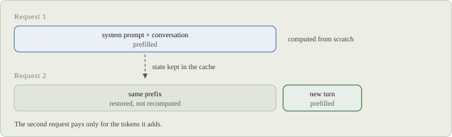

# Cache

Gufo keeps the work it did for one request so that the next request in the
same conversation only pays for what's new. This page explains what is reused,
what breaks reuse, and how to size the cache in RAM and on disk.

## Why it matters

A coding agent resends the whole conversation on every turn and adds a few
hundred tokens at the end. Without reuse, each turn processes everything
again. As of October 2026, on Strix Halo, the second turn of a long
conversation took:

| Model | Prompt | From scratch | Reused |
| --- | ---: | ---: | ---: |
| Qwen3.8 27B | 101,545 tokens | 280.4 s | 2.4 s |
| Qwen3.8 Flash-Next | 203,047 tokens | 184.4 s | 0.7 s |



*Figure 1. A repeated prefix is restored, not recomputed.*

## How reuse works

Processing a prompt, **prefill**, leaves the model in a state that depends on
every token so far. Gufo keeps that state at **checkpoints**: positions in a
conversation it can resume from. A new request resumes from the longest
checkpoint whose tokens are an exact prefix of its prompt, then prefills only
the rest.

Exact means exact. Hybrid models such as Qwen3.8 carry recurrent state that
can't be cut back to an earlier token, so a checkpoint helps only if the new
prompt contains all of its tokens unchanged. If you edit a message in the
middle of a conversation, Gufo resumes from the last checkpoint before the
edit, which may be the start.

The cheapest case is continuing the previous turn: the session that answered
it still holds its state, including the tokens it generated, so nothing needs
restoring. Gufo also keeps checkpoints at other positions, such as the end of
a shared system prompt, so different conversations that start the same way
share that work.

When several requests that share a long prefix arrive together, such as
subagents with one system prompt, the later ones wait for the first to
process the shared part and then reuse it, instead of all computing it at
once.

## What breaks reuse

Anything that changes earlier tokens of the prompt:

- adding, removing or reordering **tools**;
- a **system prompt** that changes, for example because it holds the time or
  the working directory;
- a different **response schema**;
- changing, removing or moving an earlier **image** (appending one is fine);
- a different **reasoning effort**, which is part of the prompt.

Sampling settings, `max_tokens`, `stop` and streaming don't affect reuse.

Clients usually drop the model's reasoning when they send the conversation
back. Gufo expects this and keeps a checkpoint before each answer, so the next
turn still reuses everything up to it.

## RAM

The cache lives in host RAM. By default it takes half of the RAM available
when the model loads, up to 32 GiB, and always leaves 4 GiB for the system.

```sh
gufo serve llm --model "$MODEL" --cache-ram-bytes 17179869184   # 16 GiB
```

`--cache-ram-bytes` takes a byte count; `0` means automatic and `off` turns the
RAM cache off. When the cache is full, Gufo drops the checkpoints it ranks as
least useful; the [cache reference](internal/cache.md#what-gets-retained)
describes the order. More RAM keeps more conversations warm; the startup log
reports the budget it settled on.

## Disk

`--cache-disk DIR` adds a second tier that survives restarts and holds
checkpoints that no longer fit in RAM. It's off by default.

```sh
gufo serve llm --model "$MODEL" \
  --cache-disk /var/cache/gufo/qwen --cache-disk-bytes 68719476736   # 64 GiB
```

- `--cache-disk-bytes` caps the directory, 8 GiB by default. When it's full,
  the entries used least recently go first.
- One server owns a directory; a second server pointed at it fails at startup.
  Give each server its own.
- Disk checkpoints are at least 2,048 tokens apart, so after a restart a
  conversation resumes up to 2,048 tokens before where it stopped.

As of October 2026, restoring a 24,866-token prompt from disk after a restart
took 1.8 s, against about 50 s from scratch.

## Per-request controls

| Field | Effect |
| --- | --- |
| `cache_prompt: false` | Don't reuse a checkpoint for this request. Its result can still be kept. |
| `cache_persist: false` | Keep this request's checkpoints in RAM only, never on disk. |

Both work on `/v1/chat/completions`, `/v1/responses`, `/v1/completions` and
`/completion`.

## Checking reuse

Each response reports how much was reused: `timings.cache_n` tokens came from
the cache and `timings.prompt_n` were processed. In Prometheus,
`llamacpp:prompt_tokens_cached_total` adds them up.

When `cache_n` is lower than you expect, start the server with
`--log-level debug`: each skipped checkpoint is logged with the reason it
didn't match. The [cache reference](internal/cache.md) explains every log line
and the design behind the cache.
