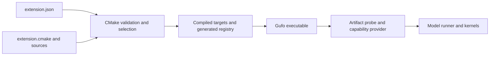

# Writing and maintaining a Gufo extension

A Gufo **source extension** adds a model implementation to an existing capability
such as text generation, embeddings, speech, image/video generation or decisions.
Gufo compiles its C++/HIP sources into the executable and generates registration
from its manifest. Users rebuild Gufo with that source to add the model.

Community and niche models live in independent repositories. Promotion to core
means accepting the in-tree maintenance and release obligations, with a named
maintainer. This guide takes a new author from the template through implementation,
validation and ongoing maintenance. The [distribution guide](model-extensions/DISTRIBUTION.md)
contains platform recipes and the full support policy.

## How the pieces fit

An extension owns model-specific artifact loading, tokenization/framing, operators,
execution and capability adapters. Gufo provides the public interfaces, registry,
HTTP serving/scheduling and shared services exposed through those interfaces.
A text runner, for example, supplies model execution and state operations used by
the host's scheduler and continuation/cache policy.



One extension can contribute several providers, and those providers can share a
backbone. Each provider has its own capability, ID, artifact keys, supported
options and execution factory. Adding a model to an existing capability should
stay within its extension and package recipe. Introducing a new capability needs
a core interface proposal and review.

Include public headers through `<gufo/ext/...>` and link the public
`gufo_ext_runtime` target. Generated metadata constants are exposed under
`<gufo/ext/generated/...>`. The [SURFACE inventory](../include/gufo/ext/SURFACE)
identifies the audited transitive source API. Private Gufo includes and links
are rejected for external extensions; keep your own implementation headers
inside your repository. The include checks enforce the source API boundary.
Extension code still has arbitrary native-code privileges during build and run.

A text runner that provides continuation implements `cache::Adapter` and links
`gufo_ext_cache`, the public target for the component cache and its HIP backing.
It exists only in HIP builds, so list it under a target that requires `hip`.

## Start with the template

Copy [examples/extension_template](../examples/extension_template/README.md) into
an independent repository. It contains:

| File | Purpose |
| --- | --- |
| `extension.json` | Identity, compatibility floor, providers, artifact keys, target requirements and inventory |
| `extension.cmake` | Targets, sources, public dependencies, tests and installation rules |
| `src/template_model.cpp` | Registration scaffold using generated metadata |
| `flake.nix`, `flake.lock` | Pinned Gufo package with this source added |
| `LICENSE`, `README.md` | Source license, ownership, build and support information |

Rename `template_model`, its target and registration symbols, the provider ID and
artifact key consistently. The template only registers metadata. Implement a
capability runner and independent tests before advertising working inference.

In the manifest, distinguish:

- `name` and `version`: this extension's identity and author-managed version.
- `api_version`: the minimum Gufo extension API needed by the interfaces you use.
- `registration_target` and `entry`: the target and function that register the
  extension's host-side behavior.
- `providers`: each capability implementation's ID, keys, model IDs, factory
  target and registration entry.
- `targets.requires`: conditions such as `hip` or `testing`; test targets use
  `role: "test"`. Disabled targets must not advertise usable device execution.
- `depends`: explicit extension/library dependencies. External consumers can use
  dependencies that satisfy the public API boundary; private family libraries
  do not become public just because an in-tree model links them.
- `options`, `packages`, `licenses`, `install_data` and `runtime_libraries`:
  option declarations and the dependency/distribution inventory. Keep them in
  agreement with the build and install recipe.

Separate host parsing/probes from HIP execution so diagnostics and probes can
work without creating a GPU context. Keep test-only code under the `testing`
condition; production packages disable it. Declare supported platforms honestly.

## A real example: `lfm3-gufo-extension`

The [LFM3 source repository](https://github.com/gufo-org/lfm3-gufo-extension)
shows a complete external implementation. The examples here refer to revision
`fb488aebef5abc3fefcbb21ce0d53eebe8cc3e27`:

| Part | What to read |
| --- | --- |
| Manifest and target layout | [`extension.json`](https://github.com/gufo-org/lfm3-gufo-extension/blob/fb488aebef5abc3fefcbb21ce0d53eebe8cc3e27/extension.json), [`extension.cmake`](https://github.com/gufo-org/lfm3-gufo-extension/blob/fb488aebef5abc3fefcbb21ce0d53eebe8cc3e27/extension.cmake) |
| Host registration and artifact resolution | [`extension.cpp`](https://github.com/gufo-org/lfm3-gufo-extension/blob/fb488aebef5abc3fefcbb21ce0d53eebe8cc3e27/extension.cpp), [`probe.cpp`](https://github.com/gufo-org/lfm3-gufo-extension/blob/fb488aebef5abc3fefcbb21ce0d53eebe8cc3e27/probe.cpp) |
| Typed text provider and runner factory | [`provider.cpp`](https://github.com/gufo-org/lfm3-gufo-extension/blob/fb488aebef5abc3fefcbb21ce0d53eebe8cc3e27/provider.cpp), [`runner.cpp`](https://github.com/gufo-org/lfm3-gufo-extension/blob/fb488aebef5abc3fefcbb21ce0d53eebe8cc3e27/runner.cpp) |
| CPU references, operators and sessions | [`reference.cpp`](https://github.com/gufo-org/lfm3-gufo-extension/blob/fb488aebef5abc3fefcbb21ce0d53eebe8cc3e27/reference.cpp), [`tests`](https://github.com/gufo-org/lfm3-gufo-extension/tree/fb488aebef5abc3fefcbb21ce0d53eebe8cc3e27/tests) |
| Published limitations and quality evidence | [`docs/QUALITY.md`](https://github.com/gufo-org/lfm3-gufo-extension/blob/fb488aebef5abc3fefcbb21ce0d53eebe8cc3e27/docs/QUALITY.md) |

Its `lfm3` extension contributes text, ASR, TTS and decision providers. The
backbone, audio, vision, text and decision targets share code while retaining
separate requirements and registration functions. Its manifest declares Linux
support. Those architectural examples do not establish Windows support or a
blanket quality verdict: its documentation records remaining API/quality failures.

The text provider registers generated metadata, then a typed execution provider:

```cpp
registry.AddProvider(gufo::ext::generated::extension_lfm3::kProvider_lfm3);
registry.AddTextProvider({
    .id = "lfm3",
    .probe = &gufo::models::lfm3::ProbeLfm3,
    .probe_gguf = &gufo::models::lfm3::ProbeLfm3Gguf,
    .create = &gufo::models::lfm3::CreateLfm3TextRunner,
    .bench_driver = &gufo::models::lfm3::RunLfm3Bench,
    .prompt_driver = &gufo::models::lfm3::RunLfm3Prompt,
    .chat_driver = &gufo::models::lfm3::RunLfm3Chat,
});
```

This excerpt belongs inside its provider registration function. Metadata makes
the provider discoverable; the typed callbacks supply actual execution. The
factory implements the public runner contract and reports errors through that
contract. CPU-only registration retains probe/resolve support with unavailable
execution factories where appropriate.

## Implement the model contract

Choose the capability interface first:

| Capability | Public header |
| --- | --- |
| Text generation | [`text.hpp`](../include/gufo/ext/text.hpp) |
| Embeddings | [`embeddings.hpp`](../include/gufo/ext/embeddings.hpp) |
| Speech recognition | [`asr.hpp`](../include/gufo/ext/asr.hpp) |
| Speech synthesis | [`tts.hpp`](../include/gufo/ext/tts.hpp) |
| Images | [`image.hpp`](../include/gufo/ext/image.hpp) |
| Video | [`video.hpp`](../include/gufo/ext/video.hpp) |
| Decisions | [`decision.hpp`](../include/gufo/ext/decision.hpp) |

Read the interface and the relevant existing provider before writing the
adapter. Implement a cheap, deterministic artifact probe, validate model
metadata/shapes, and resolve required sidecars explicitly. A declared key such
as `gguf:lfm3` helps dispatch; the probe must verify the actual artifact. It must
not need GPU initialization or load the entire model onto a device. Ambiguous
matches must remain errors; do not steal another provider's artifacts with an
overly broad probe.

For a text model, own tokenization, chat/control framing and tool syntax in the
extension. Declare supported inputs, state/persistence/resource capabilities and
sampling defaults accurately. Implement incremental execution, cancellation,
state isolation, snapshot/restore and batching only under the contracts you
advertise. To capture prefill checkpoints without ending a pass at them, declare
`in_pass_checkpoint` and `max_in_pass_checkpoints`, implement
`PrefillCheckpointBytes` and override the boundaries form of `PrefillThrough`;
each capture must equal the state a pass ending at its boundary leaves. The
single-boundary form is deprecated and captures one checkpoint per call.
Preserve sampler/constraint state and cache compatibility identities
across rollback and continuation. Draft models/heads and sidecars stay with the
target model's artifact set. Wire the CLI prompt/chat/benchmark drivers as well
as the HTTP runner when those commands are supported.

Provider options use canonical names and manifest types. CMake checks conflicting
declarations. The Nix serving helper derives provider arguments and validation
from metadata, including optional `serving` declarations. New runtime controls
also need actual command parsing/execution support; metadata alone cannot
implement them. See [Nix serving](model-extensions/serving.md).

## Build and exercise the extension

From a Gufo checkout with its documented dependencies or pinned development
shell, add an absolute external source directory:

```sh
cmake --preset gpu-test -DGUFO_EXTENSION_DIRS=/absolute/path/to/lfm3-gufo-extension
cmake --build --preset gpu-test --target gufo lfm3_config_test lfm3_ops_test --parallel 4
ctest --preset gpu-full -R '^lfm3\.(config|ops)$' --output-on-failure
build/gpu-test/gufo diagnose --section extensions --json
```

These example target names come from the pinned LFM3 build manifest; substitute
your own. A CPU build should still support its host probes and truthful
unavailable-provider diagnostics. To exercise the actual LFM3 text runner with
separately downloaded, licensed weights:

```sh
build/gpu-test/gufo prompt --model /models/LFM3-1.7B-Q8_0.gguf \
  --prompt 'What is the capital of France?' --think off
build/gpu-test/gufo serve --host 127.0.0.1 --port 8080 llm \
  --model /models/LFM3-1.7B-Q8_0.gguf --context 4096
```

Pin both source revisions for a repeatable Nix package. For example, a separate
flake can use a non-flake source input for LFM3:

```nix
{
  inputs.gufo.url = "github:gufo-org/gufo/ae7ef25f350650a94be2f798706895fa0c8aa80f";
  inputs.lfm3 = {
    url = "github:gufo-org/lfm3-gufo-extension/fb488aebef5abc3fefcbb21ce0d53eebe8cc3e27";
    flake = false;
  };
  outputs = { gufo, lfm3, ... }: {
    packages.x86_64-linux.default = gufo.packages.x86_64-linux.default.override {
      extensions = [ lfm3 ];
    };
  };
}
```

Commit its generated `flake.lock`. Review and update pins intentionally. Official
lock-mode artifacts exclude external sources absent from `extensions.lock`;
adding a source directory alone does not make it an official extension.

## Validate before publishing

Follow the [conformance guide](model-extensions/CONFORMANCE.md) for the capability
matrix, existing API suites and evidence requirements. Start with independent
configuration/tokenizer/operator tests, compare CPU/reference and GPU results,
then test actual model execution and HTTP contracts. Test session isolation,
streaming, cancellation/recovery and every advertised modality/mode. Add the
continuation and cache histories when declaring continuation support.

Keep a quality report and benchmark settings/results with the model. Pin
independent references and retain failed attempts and limitations. API wiring,
a successful prompt or a missing-model skip does not qualify a model for core.
The LFM3 repository is useful here because it separates bounded passing checks
from its unresolved full API matrix.

Install into a fresh prefix, inventory required runtime libraries/data/licenses,
and test the installed executable. Repeat on each advertised platform and on
the extracted ZIP or exact image digest being published. Source and model-weight
licenses are separate responsibilities; document both and avoid bundling weights
without the necessary redistribution rights. The [distribution recipes](model-extensions/DISTRIBUTION.md)
cover CMake, Nix, Windows and artifact auditing.

## Maintain an extension

Keep an accountable maintainer/contact, supported Gufo API/source revisions,
platforms, precision formats, weight acquisition instructions, quality gaps and
release history in your README. For each update:

1. Pin the candidate Gufo and extension revisions and rebuild. Source compatibility
   applies after rebuilding; there is no binary ABI compatibility promise.
2. Set `api_version` to a floor that includes every public contract you use.
   The requested compatibility series must match the host. CMake derives the
   host API revision from change records; do not edit its version constants.
3. Rerun affected independent numerical, API and performance checks. Retain model
   tests with the model, and keep reference fixtures independent of candidate
   changes. Changes to continuation need the affected cache/history checks.
4. Verify install data, runtime closure and notices on the promised platforms.
   Rebuild and republish artifacts with immutable source identifiers and digests.
5. Update the extension's version and compatibility/quality documentation, keeping
   failed or inconclusive evidence visible. Raising a dependency floor requires
   testing that floor and the intended supported Gufo versions.

A Gufo public-header/schema/CMake contract change requires an `ext-api` PR label
and a descriptive [change record](../include/gufo/ext/changes/README.md). An
extension author upgrading their own implementation does not change Gufo's API
revision. Experimental interfaces require particular attention when updating pins.

When the model fits Gufo's selection goals and meets core requirements, request
promotion with a named maintainer and the retained evidence. Until that review,
it remains a community extension outside the tree. If a core maintainer leaves,
seek a replacement or an explicit reviewed retirement decision; do not silently
weaken its gates. The [support policy](model-extensions/DISTRIBUTION.md#core-community-promotion-and-abandoned-maintainers)
describes that lifecycle.
