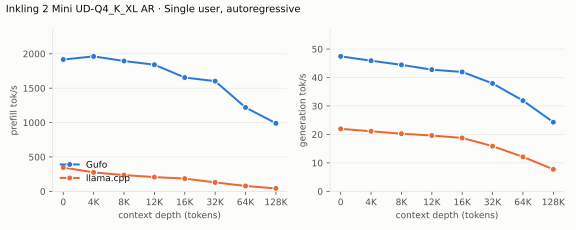
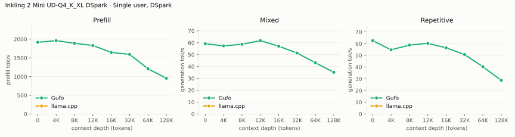
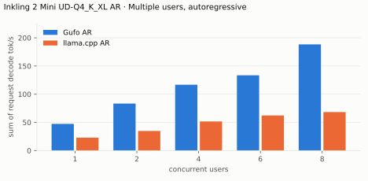
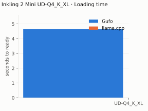

# Inkling 2 Mini benchmarks

AMD Strix Halo `gfx1151`, 128 GB unified memory, ROCm 10.1. Unsloth
`UD-Q4_K_XL` (revision `8078d149`) with its Q8_0 DSpark drafter. HTTP, greedy,
thinking off (Inkling may still think briefly). Gufo `82645e0a`; llama.cpp
`4c92c5bfb` ROCm (November 24, 2026). Positive gain favors Gufo. **TODO**
means unmeasured.
[Quality and measurement details](QUALITY.md#benchmark-method)

## Single user, autoregressive

pp2048 / tg128; depth is the cached prefix in tokens.

<!-- bench:single-ar -->
| Inkling 2 Mini UD-Q4_K_XL AR Depth (tokens) | Gufo pp (tok/s) | llama.cpp pp (tok/s) | Gain | Gufo tg (tok/s) | llama.cpp tg (tok/s) | Gain |
| ---: | ---: | ---: | ---: | ---: | ---: | ---: |
| 0 | 1916.44 | 346.56 | +453.0% | 47.42 | 21.95 | +116.0% |
| 4,096 | 1962.26 | 275.54 | +612.2% | 45.90 | 21.11 | +117.4% |
| 8,192 | 1894.84 | 236.43 | +701.4% | 44.44 | 20.26 | +119.3% |
| 12,288 | 1840.88 | 207.41 | +787.6% | 42.75 | 19.61 | +118.0% |
| 16,384 | 1654.53 | 185.51 | +791.9% | 41.95 | 18.76 | +123.6% |
| 32,768 | 1601.97 | 129.53 | +1136.8% | 37.91 | 15.88 | +138.7% |
| 65,536 | 1219.22 | 78.20 | +1459.1% | 31.88 | 12.11 | +163.3% |
| 131,072 | 989.29 | 42.46 | +2229.9% | 24.30 | 7.74 | +214.0% |
<!-- /bench -->

## Single user, DSpark

Shared pp, separate mixed/repetitive tg and gains. pp is the highest measured
rate per engine and depth across both text types. With thinking off Inkling
still thinks first, so the 128 timed tokens are its thought and the repetitive
task does not reach the copy. Output equals AR at every depth (reasoning
included). llama.cpp cannot load the DSpark drafter: N/A.

<!-- bench:single-dspark -->
| Inkling 2 Mini UD-Q4_K_XL DSpark Depth (tokens) | Gufo pp (tok/s) | llama.cpp pp (tok/s) | Gain pp | Gufo tg mixed (tok/s) | llama.cpp tg mixed (tok/s) | Gain mixed | Gufo tg repetitive (tok/s) | llama.cpp tg repetitive (tok/s) | Gain repetitive |
| ---: | ---: | ---: | ---: | ---: | ---: | ---: | ---: | ---: | ---: |
| 0 | 1916.28 | N/A | N/A | 59.14 | N/A | N/A | 62.58 | N/A | N/A |
| 4,096 | 1961.21 | N/A | N/A | 57.39 | N/A | N/A | 54.73 | N/A | N/A |
| 8,192 | 1889.51 | N/A | N/A | 58.73 | N/A | N/A | 58.78 | N/A | N/A |
| 12,288 | 1832.42 | N/A | N/A | 61.79 | N/A | N/A | 60.25 | N/A | N/A |
| 16,384 | 1644.73 | N/A | N/A | 57.10 | N/A | N/A | 56.43 | N/A | N/A |
| 32,768 | 1593.40 | N/A | N/A | 51.30 | N/A | N/A | 50.71 | N/A | N/A |
| 65,536 | 1209.49 | N/A | N/A | 43.14 | N/A | N/A | 40.29 | N/A | N/A |
| 131,072 | 953.87 | N/A | N/A | 35.11 | N/A | N/A | 28.69 | N/A | N/A |
<!-- /bench -->

## Multiple users, autoregressive

Same pp2048 prose prompt as single-user d0, tg128, context 4096 per user.
Prefill every session before timed decoding; sum individual request decode rates.

<!-- bench:multi-ar -->
| Inkling 2 Mini UD-Q4_K_XL AR Users | Gufo AR (tok/s) | llama.cpp AR (tok/s) | Gain |
| ---: | ---: | ---: | ---: |
| 1 | 47.39 | 22.89 | +107.0% |
| 2 | 83.34 | 34.78 | +139.6% |
| 4 | 116.76 | 51.70 | +125.8% |
| 6 | 133.54 | 62.26 | +114.5% |
| 8 | 188.35 | 68.33 | +175.6% |
<!-- /bench -->

## Multiple users, DSpark

Same pp2048 mixed/repetitive prompts as single-user d0, tg128. C1 directly
cross-checks that row. Prefill every session before timed decoding. Output
equals the isolated AR reference at every concurrency. llama.cpp: N/A, as
above.

<!-- bench:multi-dspark -->
| Inkling 2 Mini UD-Q4_K_XL DSpark Users | Gufo mixed (tok/s) | llama.cpp mixed (tok/s) | Gain | Gufo repetitive (tok/s) | llama.cpp repetitive (tok/s) | Gain |
| ---: | ---: | ---: | ---: | ---: | ---: | ---: |
| 1 | 56.98 | N/A | N/A | 62.90 | N/A | N/A |
| 2 | 91.33 | N/A | N/A | 93.63 | N/A | N/A |
| 4 | 126.89 | N/A | N/A | 132.33 | N/A | N/A |
| 6 | 126.74 | N/A | N/A | 131.03 | N/A | N/A |
| 8 | 187.31 | N/A | N/A | 187.38 | N/A | N/A |
<!-- /bench -->

## Loading time

C1, capacity 262,144, DSpark. Cold model files (`POSIX_FADV_DONTNEED`) to HTTP
readiness. llama.cpp: N/A (it cannot load the drafter).

<!-- bench:loading -->
| Inkling 2 Mini UD-Q4_K_XL Target | Gufo ready (s) | llama.cpp ready (s) | Gain |
| --- | ---: | ---: | ---: |
| UD-Q4_K_XL | 4.66 | N/A | N/A |
<!-- /bench -->

## Memory occupation

C1, capacity 133,121, AR, no projector. llama-server preallocates its KV
cache, so its footprint does not grow with the prefix.

<!-- bench:memory -->
| Inkling 2 Mini UD-Q4_K_XL AR Workload | Gufo GiB | llama.cpp GiB | Gain |
| --- | ---: | ---: | ---: |
| pp2048 + tg128 | 28.42 | 36.97 | +30.1% |
| 16K prefix, pp4096 + tg128 | 30.44 | 37.49 | +23.2% |
<!-- /bench -->

## DSpark after a cache restore

Greedy, 400 tokens, WikiText-2 prose plus "Summarize the text above in five
bullet points", `--context 32768`; the second and third requests restore the
whole prompt from the RAM cache. Decode tok/s, Gufo `82645e0a` (checkpoints
hold the drafter's context) against `94ef8903` (a restore dropped it).

| Inkling Q4 DSpark Prompt (tokens) | Fresh (tok/s) | Restored, before (tok/s) | Restored (tok/s) |
| ---: | ---: | ---: | ---: |
| 3,875 | 76.0 | 52.7 / 53.5 | 78.1 / 76.8 |
| 15,694 | 75.8 | 50.7 / 50.8 | 76.0 / 76.3 |
| 30,177 | 57.7 | 44.2 / 44.8 | 59.4 / 60.1 |
