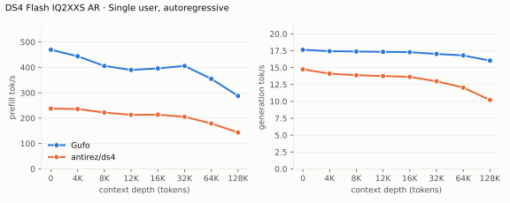
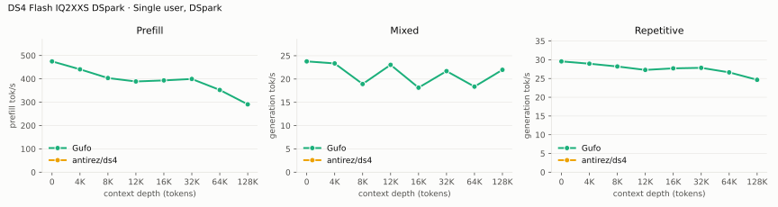
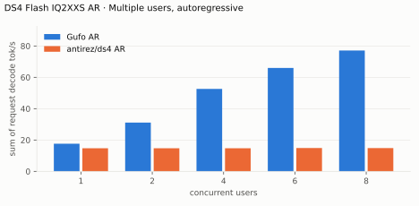
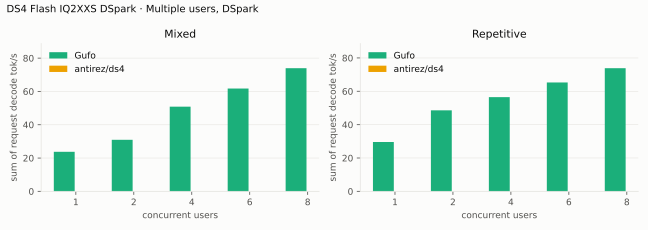
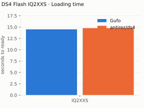
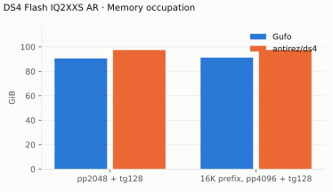

# DeepSeek V4 Flash benchmarks

AMD Strix Halo `gfx1151`, 128 GB unified memory, GTT limit 108 GiB. Antirez
Flash 0731 mixed `IQ2XXS` target, DSpark support sidecar. Greedy, thinking off.
Reference: antirez/ds4 `0aaea5a2` (ROCm 10.1).

Measured 2026-10-30. One warmed sample per point. Positive gain favors Gufo.
At 98 GiB GTT, Gufo C8 AR and C6 DSpark output and reference prefill speed differ.
[Quality and measurement details](QUALITY.md#benchmark-method).

## Single user, autoregressive

Approximately pp2048 / tg128; depth is the cached prefix in tokens.

<!-- bench:single-ar -->
| DS4 Flash IQ2XXS AR Depth (tokens) | Gufo pp (tok/s) | antirez/ds4 pp (tok/s) | Gain | Gufo tg (tok/s) | antirez/ds4 tg (tok/s) | Gain |
| ---: | ---: | ---: | ---: | ---: | ---: | ---: |
| 0 | 469.49 | 237.46 | +97.7% | 17.65 | 14.75 | +19.7% |
| 4,096 | 443.83 | 236.00 | +88.1% | 17.44 | 14.11 | +23.6% |
| 8,192 | 405.71 | 221.99 | +82.8% | 17.39 | 13.88 | +25.3% |
| 12,288 | 389.89 | 213.14 | +82.9% | 17.34 | 13.76 | +26.0% |
| 16,384 | 395.96 | 213.56 | +85.4% | 17.29 | 13.63 | +26.9% |
| 32,768 | 405.80 | 205.29 | +97.7% | 17.03 | 12.98 | +31.2% |
| 65,536 | 354.84 | 178.80 | +98.5% | 16.81 | 12.04 | +39.6% |
| 131,072 | 287.52 | 143.49 | +100.4% | 16.04 | 10.21 | +57.1% |
<!-- /bench -->

## Single user, DSpark

pp is the highest measured rate per engine and depth across mixed/repetitive
text.
Antirez DSpark is N/A: its matched C1 control changes greedy output versus AR.

<!-- bench:single-dspark -->
| DS4 Flash IQ2XXS DSpark Depth (tokens) | Gufo pp (tok/s) | antirez/ds4 pp (tok/s) | Gain pp | Gufo tg mixed (tok/s) | antirez/ds4 tg mixed (tok/s) | Gain mixed | Gufo tg repetitive (tok/s) | antirez/ds4 tg repetitive (tok/s) | Gain repetitive |
| ---: | ---: | ---: | ---: | ---: | ---: | ---: | ---: | ---: | ---: |
| 0 | 474.87 | N/A | N/A | 23.79 | N/A | N/A | 29.57 | N/A | N/A |
| 4,096 | 440.81 | N/A | N/A | 23.35 | N/A | N/A | 28.95 | N/A | N/A |
| 8,192 | 403.45 | N/A | N/A | 18.93 | N/A | N/A | 28.21 | N/A | N/A |
| 12,288 | 388.84 | N/A | N/A | 23.05 | N/A | N/A | 27.29 | N/A | N/A |
| 16,384 | 393.30 | N/A | N/A | 18.15 | N/A | N/A | 27.71 | N/A | N/A |
| 32,768 | 399.50 | N/A | N/A | 21.70 | N/A | N/A | 27.85 | N/A | N/A |
| 65,536 | 352.36 | N/A | N/A | 18.37 | N/A | N/A | 26.64 | N/A | N/A |
| 131,072 | 290.75 | N/A | N/A | 21.98 | N/A | N/A | 24.65 | N/A | N/A |
<!-- /bench -->

## Multiple users, autoregressive

Same pp2048 prose prompt as single-user d0, tg128, context 4096 per user.
All sessions prefilled before timed decoding; throughput sums individual rates.

<!-- bench:multi-ar -->
| DS4 Flash IQ2XXS AR Users | Gufo AR (tok/s) | antirez/ds4 AR (tok/s) | Gain |
| ---: | ---: | ---: | ---: |
| 1 | 17.66 | 14.76 | +19.6% |
| 2 | 31.14 | 14.74 | +111.3% |
| 4 | 52.62 | 14.77 | +256.3% |
| 6 | 66.00 | 14.89 | +343.3% |
| 8 | 77.12 | 14.85 | +419.3% |
<!-- /bench -->

## Multiple users, DSpark

Same pp2048 mixed/repetitive prompts as single-user d0, tg128, context 4096
per user. All sessions prefilled before timed decoding; rates sum individual
request decode rates. C1 cross-checks the single-user table.
N/A: Antirez C1 DSpark fails the AR-equivalence control; ROCm batching disables
DSpark at C>1. At C6 and C8, Gufo DSpark is slower than Gufo AR.

<!-- bench:multi-dspark -->
| DS4 Flash IQ2XXS DSpark Users | Gufo mixed (tok/s) | antirez/ds4 mixed (tok/s) | Gain | Gufo repetitive (tok/s) | antirez/ds4 repetitive (tok/s) | Gain |
| ---: | ---: | ---: | ---: | ---: | ---: | ---: |
| 1 | 23.76 | N/A | N/A | 29.61 | N/A | N/A |
| 2 | 30.94 | N/A | N/A | 48.60 | N/A | N/A |
| 4 | 50.84 | N/A | N/A | 56.50 | N/A | N/A |
| 6 | 61.76 | N/A | N/A | 65.30 | N/A | N/A |
| 8 | 73.95 | N/A | N/A | 73.85 | N/A | N/A |
<!-- /bench -->

## Loading time

C1, context capacity 262144, DSpark. Cold target/sidecar files to HTTP readiness.

<!-- bench:loading -->
| DS4 Flash IQ2XXS Target | Gufo ready (s) | antirez/ds4 ready (s) | Gain |
| --- | ---: | ---: | ---: |
| IQ2XXS | 14.50 | 14.77 | +1.9% |
<!-- /bench -->

## Memory occupation

C1, context capacity 262144, AR. Peak memory reported by HIP.

<!-- bench:memory -->
| DS4 Flash IQ2XXS AR Workload | Gufo GiB | antirez/ds4 GiB | Gain |
| --- | ---: | ---: | ---: |
| pp2048 + tg128 | 90.55 | 97.41 | +7.6% |
| 16K prefix, pp4096 + tg128 | 91.22 | 97.46 | +6.8% |
<!-- /bench -->

