# Gemma 4 26B-A4B benchmarks

AMD Strix Halo `gfx1151`, 128 GB unified memory. Unsloth
`gemma-4-26B-A4B-it` UD-Q4_K_XL, UD-Q6_K_XL and UD-Q8_K_XL targets with the
Unsloth Q8_0 `gemma4-assistant` MTP drafter. The UD-Q8_K_XL tables are a
reduced grid (depths to 32K, up to two users). Gufo drafts up to 15 tokens
under its calibrated length control, verifying the drafter's runner-up beside
each draft; llama.cpp drafts up to four. Gufo columns measured October 17,
2026; llama.cpp columns September 28–30. HTTP, greedy,
thinking off. llama.cpp is the repository's pinned `b11069` (ROCm) reference.
Positive gain favors Gufo. **TODO** means unmeasured.
[Quality and measurement details](QUALITY.md#benchmark-method) · [Model identities](artifacts/model-identities.json)

Other quants ([formats](README.md#other-quants)) have no HTTP tables yet.
Native `gufo bench` against `llama-bench` (b11069, `-fa 1 -ngl 99`), pp2048
and tg128, three repetitions, October 11, 2026:

| Quant | Gufo pp (tok/s) | llama.cpp pp (tok/s) | Gain | Gufo tg (tok/s) | llama.cpp tg (tok/s) | Gain |
| --- | ---: | ---: | ---: | ---: | ---: | ---: |
| QAT UD-Q4_K_XL | 4131 | 1546 | +167% | 81.4 | 69.4 | +17% |
| Fine-tune, llama.cpp Q4_K_M | 3885 | 1597 | +143% | 69.9 | 60.7 | +15% |
| UD-Q4_K_XL (control, same build) | 3939 | TODO | | 56.7 | TODO | |

## Single user, autoregressive

Approximately pp2048 / tg128; depth is the cached prefix in tokens.

<!-- bench:single-ar-q4 -->
| Gemma 4 26B-A4B UD-Q4_K_XL AR Depth (tokens) | Gufo pp (tok/s) | llama.cpp pp (tok/s) | Gain | Gufo tg (tok/s) | llama.cpp tg (tok/s) | Gain |
| ---: | ---: | ---: | ---: | ---: | ---: | ---: |
| 0 | 3935.42 | 1684.76 | +133.6% | 53.52 | 43.96 | +21.7% |
| 4,096 | 3536.35 | 1404.62 | +151.8% | 52.90 | 43.26 | +22.3% |
| 8,192 | 3338.19 | 1251.89 | +166.7% | 52.69 | 42.58 | +23.7% |
| 12,288 | 2953.14 | 1115.27 | +164.8% | 51.99 | 41.94 | +24.0% |
| 16,384 | 2922.90 | 1022.60 | +185.8% | 50.46 | 41.42 | +21.8% |
| 32,768 | 2346.97 | 746.17 | +214.5% | 48.38 | 38.57 | +25.4% |
| 65,536 | 1623.93 | 472.56 | +243.6% | 44.56 | 35.12 | +26.9% |
| 131,072 | 1005.00 | 281.37 | +257.2% | 38.16 | 29.42 | +29.7% |
<!-- /bench -->

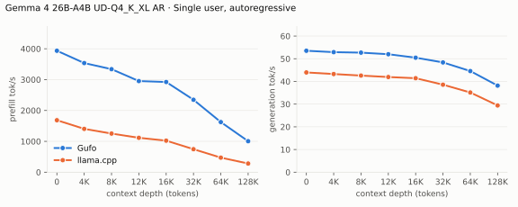

---

<!-- bench:single-ar-q6 -->
| Gemma 4 26B-A4B UD-Q6_K_XL AR Depth (tokens) | Gufo pp (tok/s) | llama.cpp pp (tok/s) | Gain | Gufo tg (tok/s) | llama.cpp tg (tok/s) | Gain |
| ---: | ---: | ---: | ---: | ---: | ---: | ---: |
| 0 | 3803.62 | 1425.52 | +166.8% | 48.94 | 40.94 | +19.5% |
| 4,096 | 3438.82 | 1215.03 | +183.0% | 48.42 | 40.33 | +20.1% |
| 8,192 | 3278.80 | 1103.41 | +197.2% | 48.21 | 39.75 | +21.3% |
| 12,288 | 2862.45 | 996.77 | +187.2% | 47.66 | 39.19 | +21.6% |
| 16,384 | 2846.61 | 918.82 | +209.8% | 46.30 | 38.75 | +19.5% |
| 32,768 | 2298.43 | 679.89 | +238.1% | 44.57 | 36.64 | +21.6% |
| 65,536 | 1585.96 | 447.13 | +254.7% | 41.28 | 33.19 | +24.4% |
| 131,072 | 992.83 | 268.45 | +269.8% | 35.73 | 27.98 | +27.7% |
<!-- /bench -->

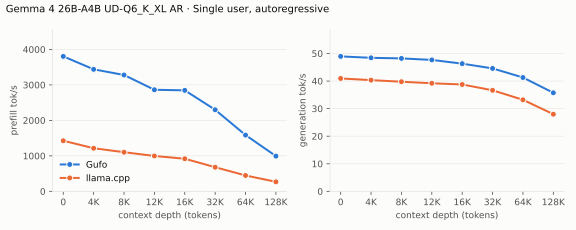

---

<!-- bench:single-ar-q8 -->
| Gemma 4 26B-A4B UD-Q8_K_XL AR Depth (tokens) | Gufo pp (tok/s) | llama.cpp pp (tok/s) | Gain | Gufo tg (tok/s) | llama.cpp tg (tok/s) | Gain |
| ---: | ---: | ---: | ---: | ---: | ---: | ---: |
| 0 | 3780.98 | 1392.01 | +171.6% | 45.97 | 38.69 | +18.8% |
| 4,096 | 3428.30 | 1212.07 | +182.8% | 45.52 | 38.17 | +19.3% |
| 16,384 | 2679.06 | 907.60 | +195.2% | 43.72 | 36.66 | +19.3% |
| 32,768 | 2310.28 | 680.43 | +239.5% | 42.14 | 34.84 | +21.0% |
<!-- /bench -->

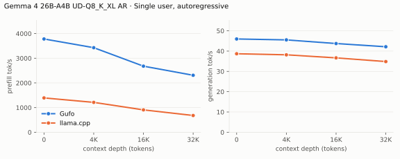

## Single user, MTP

pp is the highest measured rate per engine and depth across mixed/repetitive
text. Greedy texts differ between the engines, so accepted drafts per cycle
differ per depth (artifacts). Over the same HTTP path Gufo's AR decodes at
53.5 (Q4), 48.9 (Q6) and 46.0 (Q8) tok/s at d0.

<!-- bench:single-mtp-q4 -->
| Gemma 4 26B-A4B UD-Q4_K_XL MTP Depth (tokens) | Gufo pp (tok/s) | llama.cpp pp (tok/s) | Gain pp | Gufo tg mixed (tok/s) | llama.cpp tg mixed (tok/s) | Gain mixed | Gufo tg repetitive (tok/s) | llama.cpp tg repetitive (tok/s) | Gain repetitive |
| ---: | ---: | ---: | ---: | ---: | ---: | ---: | ---: | ---: | ---: |
| 0 | 3943.60 | 1630.60 | +141.8% | 78.75 | 57.61 | +36.7% | 267.07 | 62.06 | +330.3% |
| 4,096 | 3543.51 | 1351.13 | +162.3% | 80.68 | 58.64 | +37.6% | 225.41 | 65.36 | +244.9% |
| 8,192 | 3370.20 | 1199.20 | +181.0% | 81.03 | 56.85 | +42.5% | 290.37 | 39.35 | +637.9% |
| 12,288 | 2931.79 | 1051.25 | +178.9% | 83.54 | 56.72 | +47.3% | 241.90 | 45.61 | +430.4% |
| 16,384 | 2832.00 | 957.77 | +195.7% | 70.50 | 49.12 | +43.5% | 207.39 | 57.46 | +260.9% |
| 32,768 | 2276.48 | 704.89 | +223.0% | 70.08 | 39.98 | +75.3% | 218.71 | 61.27 | +257.0% |
| 65,536 | 1559.54 | 461.26 | +238.1% | 74.83 | 31.41 | +138.2% | 172.38 | 32.73 | +426.7% |
| 131,072 | 1006.61 | 276.99 | +263.4% | 53.73 | 20.98 | +156.1% | 129.25 | 22.16 | +483.3% |
<!-- /bench -->

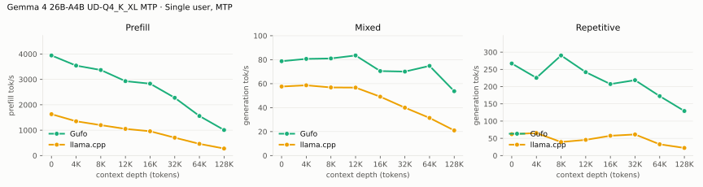

---

<!-- bench:single-mtp-q6 -->
| Gemma 4 26B-A4B UD-Q6_K_XL MTP Depth (tokens) | Gufo pp (tok/s) | llama.cpp pp (tok/s) | Gain pp | Gufo tg mixed (tok/s) | llama.cpp tg mixed (tok/s) | Gain mixed | Gufo tg repetitive (tok/s) | llama.cpp tg repetitive (tok/s) | Gain repetitive |
| ---: | ---: | ---: | ---: | ---: | ---: | ---: | ---: | ---: | ---: |
| 0 | 3800.58 | 1393.42 | +172.8% | 72.01 | 54.03 | +33.3% | 263.54 | 58.75 | +348.6% |
| 4,096 | 3444.22 | 1183.58 | +191.0% | 71.62 | 54.17 | +32.2% | 206.84 | 63.89 | +223.7% |
| 8,192 | 3249.87 | 1043.91 | +211.3% | 77.86 | 50.06 | +55.5% | 268.91 | 39.41 | +582.3% |
| 12,288 | 2832.43 | 943.21 | +200.3% | 76.69 | 54.67 | +40.3% | 228.04 | 58.98 | +286.6% |
| 16,384 | 2779.24 | 864.65 | +221.4% | 76.28 | 45.14 | +69.0% | 188.58 | 52.93 | +256.3% |
| 32,768 | 2232.37 | 651.38 | +242.7% | 64.28 | 37.61 | +70.9% | 223.92 | 60.24 | +271.7% |
| 65,536 | 1528.51 | 435.03 | +251.4% | 62.59 | 33.29 | +88.0% | 163.63 | 31.08 | +426.5% |
| 131,072 | 994.49 | 265.20 | +275.0% | 49.57 | 22.62 | +119.1% | 123.70 | 15.26 | +710.6% |
<!-- /bench -->

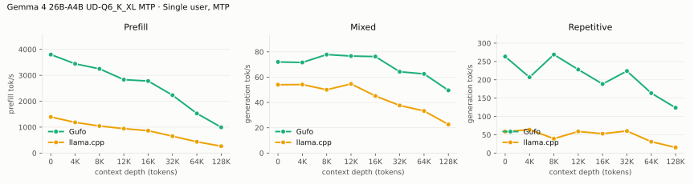

---

<!-- bench:single-mtp-q8 -->
| Gemma 4 26B-A4B UD-Q8_K_XL MTP Depth (tokens) | Gufo pp (tok/s) | llama.cpp pp (tok/s) | Gain pp | Gufo tg mixed (tok/s) | llama.cpp tg mixed (tok/s) | Gain mixed | Gufo tg repetitive (tok/s) | llama.cpp tg repetitive (tok/s) | Gain repetitive |
| ---: | ---: | ---: | ---: | ---: | ---: | ---: | ---: | ---: | ---: |
| 0 | 3789.26 | 1376.85 | +175.2% | 73.01 | 47.09 | +55.0% | 249.04 | 54.45 | +357.4% |
| 4,096 | 3441.40 | 1175.04 | +192.9% | 69.30 | 49.15 | +41.0% | 194.17 | 58.39 | +232.5% |
| 16,384 | 2840.98 | 885.18 | +220.9% | 67.11 | 47.25 | +42.0% | 194.53 | 54.67 | +255.8% |
| 32,768 | 2317.86 | 659.89 | +251.2% | 63.78 | 34.99 | +82.3% | 205.56 | 58.45 | +251.7% |
<!-- /bench -->

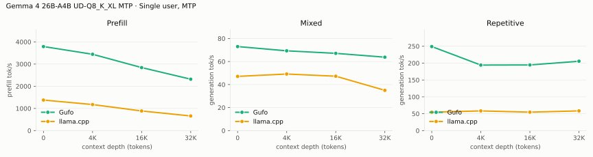

## Single user, sampled MTP

Temperature 1, top-k 64, top-p 0.95, repeat penalty 1.05; a story-writing turn
after the cached prefix. Mean of five requests with seeds 1–5. Seed 3's prompt
is 2051 tokens; a prefill chunk past 2048 tokens runs about 5% slower, which
widens Gufo's prefill spread.

<!-- bench:single-mtp-sampled-q4 -->
| Gemma 4 26B-A4B UD-Q4_K_XL MTP Depth (tokens) | Gufo pp (tok/s) | llama.cpp pp (tok/s) | Gain | Gufo tg (tok/s) | llama.cpp tg (tok/s) | Gain |
| ---: | ---: | ---: | ---: | ---: | ---: | ---: |
| 0 | 3898.13 ± 16.87 | 1580.72 ± 16.34 | +146.6% | 73.84 ± 2.68 | 51.02 ± 3.74 | +44.7% |
<!-- /bench -->

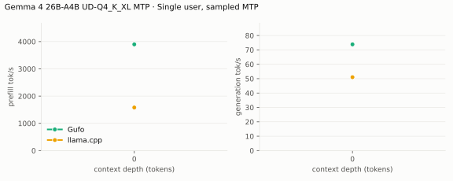

---

<!-- bench:single-mtp-sampled-q6 -->
| Gemma 4 26B-A4B UD-Q6_K_XL MTP Depth (tokens) | Gufo pp (tok/s) | llama.cpp pp (tok/s) | Gain | Gufo tg (tok/s) | llama.cpp tg (tok/s) | Gain |
| ---: | ---: | ---: | ---: | ---: | ---: | ---: |
| 0 | 3774.42 ± 14.54 | 1360.32 ± 10.89 | +177.5% | 68.84 ± 3.02 | 45.05 ± 2.29 | +52.8% |
<!-- /bench -->

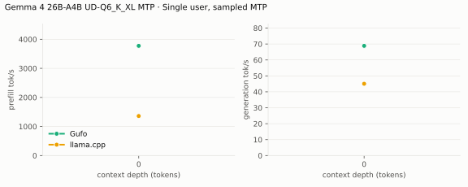

---

<!-- bench:single-mtp-sampled-q8 -->
| Gemma 4 26B-A4B UD-Q8_K_XL MTP Depth (tokens) | Gufo pp (tok/s) | llama.cpp pp (tok/s) | Gain | Gufo tg (tok/s) | llama.cpp tg (tok/s) | Gain |
| ---: | ---: | ---: | ---: | ---: | ---: | ---: |
| 0 | 3758.94 ± 12.37 | 1364.58 ± 5.04 | +175.5% | 61.98 ± 3.88 | 39.46 ± 3.53 | +57.1% |
<!-- /bench -->

## Multiple users, autoregressive

Same pp2048 prose prompt as single-user d0, tg128, context 4096 per user.
All sessions prefilled before timed decoding; throughput sums individual rates.

<!-- bench:multi-ar-q4 -->
| Gemma 4 26B-A4B UD-Q4_K_XL AR Users | Gufo AR (tok/s) | llama.cpp AR (tok/s) | Gain |
| ---: | ---: | ---: | ---: |
| 1 | 53.45 | 43.99 | +21.5% |
| 2 | 92.78 | 71.85 | +29.1% |
| 4 | 150.89 | 106.17 | +42.1% |
| 6 | 183.89 | 129.53 | +42.0% |
| 8 | 214.26 | 146.37 | +46.4% |
<!-- /bench -->

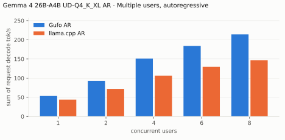

---

<!-- bench:multi-ar-q6 -->
| Gemma 4 26B-A4B UD-Q6_K_XL AR Users | Gufo AR (tok/s) | llama.cpp AR (tok/s) | Gain |
| ---: | ---: | ---: | ---: |
| 1 | 48.90 | 40.76 | +20.0% |
| 2 | 86.86 | 66.71 | +30.2% |
| 4 | 136.19 | 95.56 | +42.5% |
| 6 | 170.81 | 122.78 | +39.1% |
| 8 | 201.29 | 133.78 | +50.5% |
<!-- /bench -->

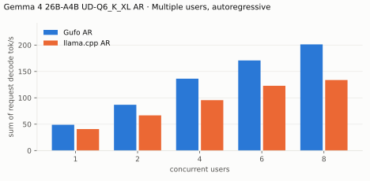

---

<!-- bench:multi-ar-q8 -->
| Gemma 4 26B-A4B UD-Q8_K_XL AR Users | Gufo AR (tok/s) | llama.cpp AR (tok/s) | Gain |
| ---: | ---: | ---: | ---: |
| 1 | 45.97 | 38.46 | +19.5% |
| 2 | 82.53 | 59.11 | +39.6% |
<!-- /bench -->

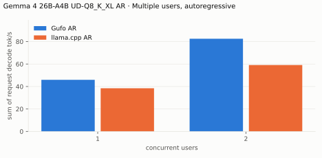

## Multiple users, MTP

Same pp2048 mixed/repetitive prompts as single-user d0, tg128. C1 directly
cross-checks that row. All sessions prefilled before timed decoding. Gufo
prices each session's drafts against the whole batched forward, so at C8
mixed text decodes 1–7% faster than batched AR.

<!-- bench:multi-mtp-q4 -->
| Gemma 4 26B-A4B UD-Q4_K_XL MTP Users | Gufo mixed (tok/s) | llama.cpp mixed (tok/s) | Gain | Gufo repetitive (tok/s) | llama.cpp repetitive (tok/s) | Gain |
| ---: | ---: | ---: | ---: | ---: | ---: | ---: |
| 1 | 80.19 | 56.96 | +40.8% | 275.42 | 61.64 | +346.8% |
| 2 | 138.42 | 89.93 | +53.9% | 320.12 | 102.28 | +213.0% |
| 4 | 188.32 | 126.24 | +49.2% | 319.66 | 140.44 | +127.6% |
| 6 | 200.19 | 160.35 | +24.8% | 351.70 | 171.28 | +105.3% |
| 8 | 229.58 | 184.92 | +24.2% | 299.72 | 196.02 | +52.9% |
<!-- /bench -->

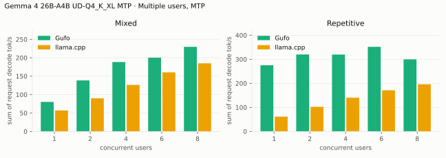

---

<!-- bench:multi-mtp-q6 -->
| Gemma 4 26B-A4B UD-Q6_K_XL MTP Users | Gufo mixed (tok/s) | llama.cpp mixed (tok/s) | Gain | Gufo repetitive (tok/s) | llama.cpp repetitive (tok/s) | Gain |
| ---: | ---: | ---: | ---: | ---: | ---: | ---: |
| 1 | 73.87 | 51.22 | +44.2% | 267.28 | 57.94 | +361.3% |
| 2 | 124.08 | 81.47 | +52.3% | 282.28 | 90.28 | +212.7% |
| 4 | 158.09 | 113.95 | +38.7% | 307.14 | 131.20 | +134.1% |
| 6 | 186.15 | 152.44 | +22.1% | 334.28 | 167.68 | +99.4% |
| 8 | 204.20 | 170.86 | +19.5% | 290.23 | 197.08 | +47.3% |
<!-- /bench -->

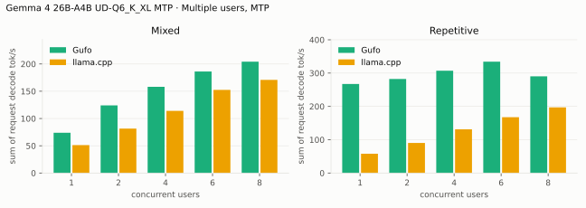

---

<!-- bench:multi-mtp-q8 -->
| Gemma 4 26B-A4B UD-Q8_K_XL MTP Users | Gufo mixed (tok/s) | llama.cpp mixed (tok/s) | Gain | Gufo repetitive (tok/s) | llama.cpp repetitive (tok/s) | Gain |
| ---: | ---: | ---: | ---: | ---: | ---: | ---: |
| 1 | 73.82 | 47.59 | +55.1% | 247.77 | 52.22 | +374.5% |
| 2 | 122.32 | 75.70 | +61.6% | 275.81 | 88.95 | +210.1% |
<!-- /bench -->

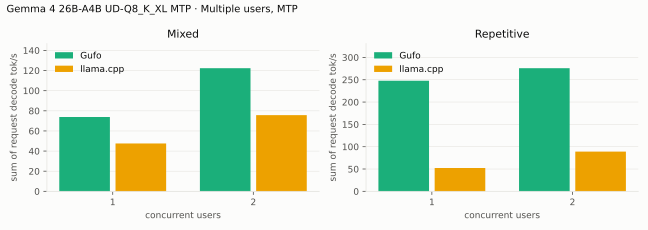

## Image requests

UD-Q4_K_XL, single user, AR, context 16384, the method of the
[31B image requests](../gemma-4-31b/BENCHMARKS.md#image-requests): the same
four images pre-resized to multiples of 48, Gufo at `--image-tokens 280` or
`1120`, llama.cpp b11069 with `-b 2048 -ub 2048` and its default token range.
Cold: a fresh nonce precedes the image; follow-up: the next user turn,
reusing the image prefix. Median of three warmed requests, 64 output tokens,
greedy ([Gufo 280](artifacts/image-q4-gufo-280.json),
[Gufo 1120](artifacts/image-q4-gufo-1120.json),
[llama.cpp](artifacts/image-q4-reference.json); `tools/gemma4/image_bench.py`).

| Image | Budget | Prompt tokens | Gufo cold TTFT (s) | llama.cpp cold TTFT (s) | Gain | Gufo follow-up TTFT (s) | llama.cpp follow-up TTFT (s) | Gain | Gufo tg (tok/s) | llama.cpp tg (tok/s) | Gain |
| --- | ---: | ---: | ---: | ---: | ---: | ---: | ---: | ---: | ---: | ---: | ---: |
| Chart 624×960 | 280 | 312 | 0.36 | 0.74 | +105.7% | 0.10 | 0.22 | +110.2% | 53.11 | 44.66 | +18.9% |
| Logo 768×768 | 280 | 309 | 0.36 | 0.74 | +108.2% | 0.10 | 0.22 | +119.0% | 53.12 | 43.12 | +23.2% |
| Chart 1296×1968 | 1120 | 1159 | 1.63 | 4.49 | +175.9% | 0.15 | 0.37 | +148.8% | 51.50 | 38.09 | +35.2% |
| Logo 1584×1584 | 1120 | 1142 | 1.63 | 4.39 | +169.9% | 0.16 | 0.39 | +138.7% | 51.53 | 36.98 | +39.4% |

Gain is llama.cpp time over Gufo time minus one (decode: Gufo over
llama.cpp). The vision encoder is the 31B's (162 ms for 260 soft tokens,
1,147 ms for 1,107); most of a cold 1,120-token request is the encoder.

## Loading time

C1, context capacity 262144, MTP. Cold model files to HTTP readiness, with no
vision sidecar beside the target. With `mmproj-BF16.gguf` beside it Gufo also
prepares the vision encoder at load: about 0.7 s more.

<!-- bench:loading -->
| Gemma 4 26B-A4B Target | Gufo ready (s) | llama.cpp ready (s) | Gain |
| --- | ---: | ---: | ---: |
| UD-Q4_K_XL | 4.03 | 5.63 | +39.7% |
| UD-Q6_K_XL | 4.92 | 6.84 | +39.0% |
| UD-Q8_K_XL | 5.69 | 7.65 | +34.4% |
<!-- /bench -->

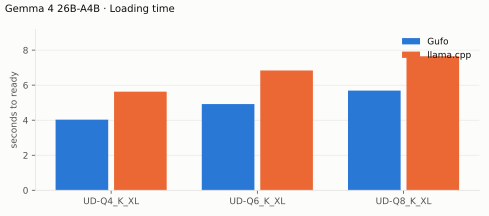

## Memory occupation

Context capacity 133121, autoregressive, no vision sidecar (with
`mmproj-BF16.gguf` beside the target Gufo holds 2.4 GiB more for the prepared
vision encoder). llama.cpp preallocates its KV
cache, so its footprint does not grow with the prefix. Gufo's figure includes
its prompt cache snapshots (see the
[31B](../gemma-4-31b/BENCHMARKS.md#memory-occupation)); llama.cpp runs with
`--cache-ram 0`.

<!-- bench:memory-q4 -->
| Gemma 4 26B-A4B UD-Q4_K_XL AR Workload | Gufo GiB | llama.cpp GiB | Gain |
| --- | ---: | ---: | ---: |
| pp2048 + tg128 | 22.73 | 23.64 | +4.0% |
| 16K prefix, pp4096 + tg128 | 24.38 | 24.18 | -0.8% |
<!-- /bench -->

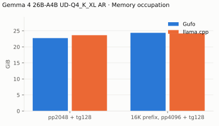

---

<!-- bench:memory-q6 -->
| Gemma 4 26B-A4B UD-Q6_K_XL AR Workload | Gufo GiB | llama.cpp GiB | Gain |
| --- | ---: | ---: | ---: |
| pp2048 + tg128 | 28.57 | 29.49 | +3.2% |
| 16K prefix, pp4096 + tg128 | 30.22 | 30.03 | -0.6% |
<!-- /bench -->

---

<!-- bench:memory-q8 -->
| Gemma 4 26B-A4B UD-Q8_K_XL AR Workload | Gufo GiB | llama.cpp GiB | Gain |
| --- | ---: | ---: | ---: |
| pp2048 + tg128 | 32.63 | 33.59 | +2.9% |
| 16K prefix, pp4096 + tg128 | 34.29 | 34.14 | -0.4% |
<!-- /bench -->

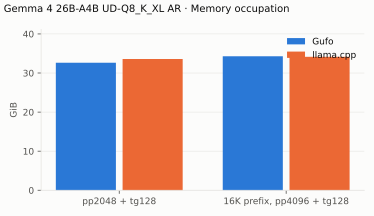

## Verification attention kernel A/B (2026-10-19)

The foldable DPP reductions compared with 04d70a14 on gfx1151, using
production arithmetic flags. Full attention launch including merge; medians
of seven alternating A/B rounds. Every output is byte-identical, including
queries scaled 10× and 30×. These are per-layer kernel times.

| Context | Rows | Before (µs) | After (µs) | Time change |
| ---: | ---: | ---: | ---: | ---: |
| 32,768 | 5 | 929.7 | 914.3 | -1.7% |
| 32,768 | 8 | 1313.1 | 1219.4 | -7.1% |
| 32,768 | 16 | 2493.9 | 2321.1 | -6.9% |
| 65,536 | 5 | 1733.8 | 1666.3 | -3.9% |
| 65,536 | 8 | 2533.4 | 2377.3 | -6.2% |
| 65,536 | 16 | 4913.5 | 4595.9 | -6.5% |

[Every row, depth, timing round and calibrated cost delta](../gemma-4-31b/artifacts/mtp-verification-2026-10-19.json).

## MTP attention, depth ABBA (2026-10-20)

UD-Q4_K_XL, production `release` binaries: `519dfe9c` (same source as
`eb17a526`) against `422fbe4d`, including the recalibrated draft costs.
Greedy, seed 1; fresh processes in baseline/candidate/candidate/baseline
order. Rates below are decode-only or prefill-only, as labeled; gains use
the two rates' means. Each request/phase is checked separately at 5% and
3 ms in the artifact.

Native `gufo bench -p 2048 -n 128 -d 16384,32768 -r 1 --verbose`.
Prefill and decode are separate measurements; depth preparation is untimed.
The synthetic repetitive decode exercises wide verification and prompt lookup.

| Gemma 4 26B-A4B UD-Q4_K_XL MTP Depth (tokens) | Phase | Baseline 1 / 2 (tok/s) | Candidate 1 / 2 (tok/s) | Gain |
| ---: | --- | ---: | ---: | ---: |
| 16,384 | pp2048 | 2911.80 / 2912.49 | 2903.56 / 2914.18 | -0.1% |
| 16,384 | tg128 | 236.79 / 237.06 | 239.11 / 239.09 | +0.9% |
| 32,768 | pp2048 | 2291.52 / 2291.27 | 2289.39 / 2289.21 | -0.1% |
| 32,768 | tg128 | 207.50 / 207.74 | 211.05 / 211.21 | +1.7% |

HTTP C1, context 40960, one short warmup per fresh server. Default-policy
summary and essay: the original frozen ~31K-token document, 400 output
tokens each. The code edit renames a dataclass in a supplied module after
an archive of similar depth (512 output tokens). A separate fixed-policy
11-draft control warms that shape with 128 output tokens, then repeats the
same prompt for 512; the cap exercises the 9–12-row launch range with ragged lookup/tail rows.

| Gemma 4 26B-A4B UD-Q4_K_XL MTP Request | Baseline 1 / 2 (tok/s) | Candidate 1 / 2 (tok/s) | Gain |
| --- | ---: | ---: | ---: |
| Summary, default | 75.87 / 75.79 | 76.24 / 76.22 | +0.5% |
| Essay, default | 75.60 / 75.65 | 75.00 / 74.93 | -0.9% |
| Code edit, default | 206.07 / 206.40 | 208.58 / 208.72 | +1.2% |
| Code edit, fixed 11 drafts | 193.28 / 194.59 | 195.55 / 196.25 | +1.0% |

[All rounds, counts, hashes, timings and phase verdicts](../gemma-4-31b/artifacts/mtp-attention-e2e-2026-10-20.json).

All HTTP texts and token/cache counts match across the four arms. Default
code edit uses the same 43 cycles and 539 proposals on every arm; the
11-draft control uses 54 cycles and 484 proposals, including ragged
lookup/tail rows. All per-request timing checks remain within 5% / 3 ms.
The observed gains are below that threshold; this is a small numerical
improvement rather than a qualified material speedup. Whole-request code
latency is 6.08 → 6.05 s (default) and 2.65 → 2.62 s (11-draft control).
The historical llama.cpp tables retain their original measurements.
