# Gemma 4 31B benchmarks

AMD Strix Halo `gfx1151`, 128 GB unified memory. Unsloth `UD-Q4_K_XL` and
`UD-Q8_K_XL` targets and their `gemma4-assistant` Q8_0 MTP drafter. Gufo
drafts up to 15 tokens under its calibrated length control, verifying the
drafter's runner-up beside each draft; llama.cpp drafts up to four. The Q8
tables are a reduced grid (depths to 32K, up to two users). Gufo columns
measured October 17, 2026; llama.cpp columns September 26–30.
HTTP, greedy, thinking off. llama.cpp is the repository's pinned `b11069`
(ROCm) reference for AR and MTP.
Positive gain favors Gufo. **TODO** means unmeasured.
[Quality and measurement details](QUALITY.md#benchmark-method) · [Model identities](artifacts/model-identities.json)

## Single user, autoregressive

Approximately pp2048 / tg128; depth is the cached prefix in tokens.

<!-- bench:single-ar -->
| Gemma 4 31B Q4 AR Depth (tokens) | Gufo pp (tok/s) | llama.cpp pp (tok/s) | Gain | Gufo tg (tok/s) | llama.cpp tg (tok/s) | Gain |
| ---: | ---: | ---: | ---: | ---: | ---: | ---: |
| 0 | 563.84 | 300.91 | +87.4% | 11.01 | 9.80 | +12.3% |
| 4,096 | 531.40 | 264.62 | +100.8% | 10.89 | 9.61 | +13.3% |
| 8,192 | 499.92 | 239.48 | +108.8% | 10.61 | 9.43 | +12.5% |
| 12,288 | 460.62 | 215.96 | +113.3% | 10.63 | 9.26 | +14.8% |
| 16,384 | 451.97 | 202.00 | +123.7% | 10.48 | 9.11 | +15.0% |
| 32,768 | 390.92 | 154.12 | +153.6% | 10.03 | 8.51 | +17.9% |
| 65,536 | 304.98 | 104.28 | +192.5% | 9.23 | 7.53 | +22.6% |
| 131,072 | 212.78 | 64.56 | +229.6% | 7.94 | 6.12 | +29.7% |
<!-- /bench -->

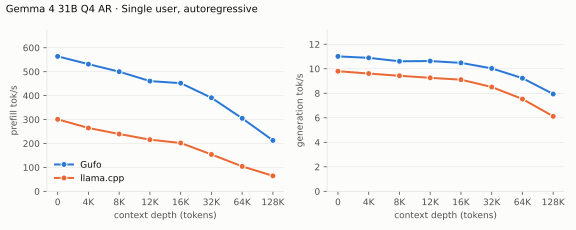

---

<!-- bench:single-ar-q8 -->
| Gemma 4 31B Q8 AR Depth (tokens) | Gufo pp (tok/s) | llama.cpp pp (tok/s) | Gain | Gufo tg (tok/s) | llama.cpp tg (tok/s) | Gain |
| ---: | ---: | ---: | ---: | ---: | ---: | ---: |
| 0 | 551.25 | 309.27 | +78.2% | 6.35 | 5.84 | +8.7% |
| 4,096 | 500.66 | 271.60 | +84.3% | 6.31 | 5.77 | +9.4% |
| 16,384 | 429.23 | 203.60 | +110.8% | 6.17 | 5.59 | +10.4% |
| 32,768 | 387.55 | 155.38 | +149.4% | 6.02 | 5.36 | +12.3% |
<!-- /bench -->

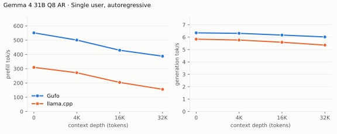

## Single user, MTP

pp is the highest measured rate per engine and depth across mixed/repetitive
text.

<!-- bench:single-mtp -->
| Gemma 4 31B Q4 MTP Depth (tokens) | Gufo pp (tok/s) | llama.cpp pp (tok/s) | Gain pp | Gufo tg mixed (tok/s) | llama.cpp tg mixed (tok/s) | Gain mixed | Gufo tg repetitive (tok/s) | llama.cpp tg repetitive (tok/s) | Gain repetitive |
| ---: | ---: | ---: | ---: | ---: | ---: | ---: | ---: | ---: | ---: |
| 0 | 571.26 | 294.20 | +94.2% | 27.24 | 19.08 | +42.8% | 119.04 | 31.11 | +282.6% |
| 4,096 | 520.80 | 253.33 | +105.6% | 24.68 | 20.32 | +21.5% | 109.70 | 32.28 | +239.8% |
| 8,192 | 490.91 | 231.63 | +111.9% | 24.60 | 18.58 | +32.4% | 116.16 | 28.74 | +304.2% |
| 12,288 | 460.84 | 211.21 | +118.2% | 24.67 | 18.14 | +36.0% | 101.63 | 28.37 | +258.2% |
| 16,384 | 451.12 | 195.22 | +131.1% | 23.57 | 15.95 | +47.8% | 87.40 | 27.19 | +221.4% |
| 32,768 | 391.48 | 150.59 | +160.0% | 21.69 | 14.89 | +45.7% | 83.35 | 21.08 | +295.4% |
| 65,536 | 304.29 | 102.73 | +196.2% | 18.41 | 10.56 | +74.3% | 62.21 | 14.85 | +318.9% |
| 131,072 | 213.37 | 63.79 | +234.5% | 14.20 | 6.92 | +105.2% | 45.33 | 4.09 | +1008.3% |
<!-- /bench -->

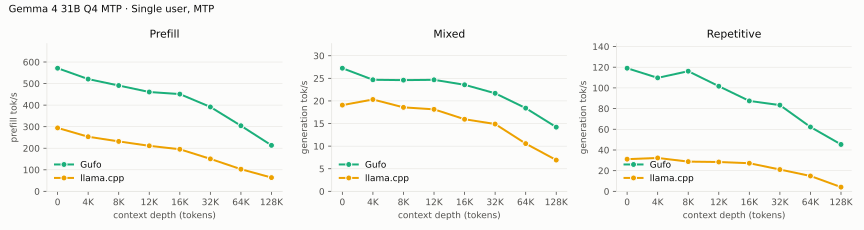

---

<!-- bench:single-mtp-q8 -->
| Gemma 4 31B Q8 MTP Depth (tokens) | Gufo pp (tok/s) | llama.cpp pp (tok/s) | Gain pp | Gufo tg mixed (tok/s) | llama.cpp tg mixed (tok/s) | Gain mixed | Gufo tg repetitive (tok/s) | llama.cpp tg repetitive (tok/s) | Gain repetitive |
| ---: | ---: | ---: | ---: | ---: | ---: | ---: | ---: | ---: | ---: |
| 0 | 555.62 | 301.96 | +84.0% | 15.88 | 13.45 | +18.1% | 61.50 | 22.34 | +175.3% |
| 4,096 | 511.53 | 256.10 | +99.7% | 17.83 | 13.75 | +29.7% | 55.90 | 23.52 | +137.7% |
| 16,384 | 443.11 | 197.65 | +124.2% | 16.99 | 12.63 | +34.5% | 54.22 | 20.58 | +163.5% |
| 32,768 | 390.87 | 151.24 | +158.4% | 15.10 | 10.95 | +37.9% | 45.98 | 14.68 | +213.2% |
<!-- /bench -->

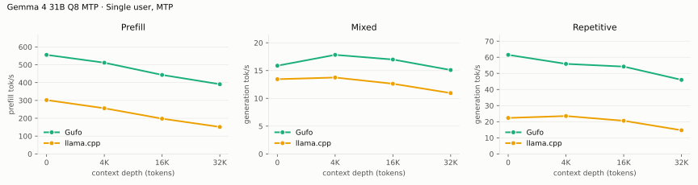

## Single user, sampled MTP

The sampler of a typical chat front end: temperature 1, top-k 64, top-p 0.95,
repeat penalty 1.05; a story-writing turn after the cached prefix (the prefix
turn itself is greedy). Mean of five requests with seeds 1–5; sampled text
differs between engines and runs, so acceptance varies more than in the
greedy tables.

<!-- bench:single-mtp-sampled -->
| Gemma 4 31B Q4 MTP Depth (tokens) | Gufo pp (tok/s) | llama.cpp pp (tok/s) | Gain | Gufo tg (tok/s) | llama.cpp tg (tok/s) | Gain |
| ---: | ---: | ---: | ---: | ---: | ---: | ---: |
| 0 | 561.33 ± 1.51 | 291.19 ± 2.26 | +92.8% | 22.32 ± 0.78 | 17.77 ± 1.56 | +25.6% |
<!-- /bench -->

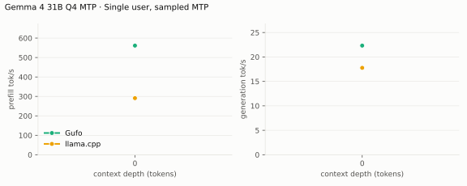

---

<!-- bench:single-mtp-sampled-q8 -->
| Gemma 4 31B Q8 MTP Depth (tokens) | Gufo pp (tok/s) | llama.cpp pp (tok/s) | Gain | Gufo tg (tok/s) | llama.cpp tg (tok/s) | Gain |
| ---: | ---: | ---: | ---: | ---: | ---: | ---: |
| 0 | 551.13 ± 5.84 | 294.38 ± 2.39 | +87.2% | 15.13 ± 1.42 | 12.28 ± 0.77 | +23.2% |
<!-- /bench -->

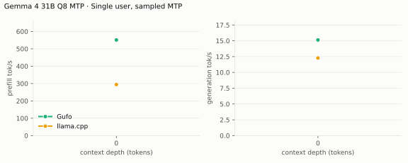

## Multiple users, autoregressive

Same pp2048 prose prompt as single-user d0, tg128, context 4096 per user.
All sessions prefilled before timed decoding; throughput sums individual rates.
Gufo decodes up to eight sessions in one forward: row-wise work runs once for
all of them, attention per session. Every session reads its own sliding-window
cache (16 MB per layer), about a fifth of an eight-user step.

<!-- bench:multi-ar -->
| Gemma 4 31B Q4 AR Users | Gufo AR (tok/s) | llama.cpp AR (tok/s) | Gain |
| ---: | ---: | ---: | ---: |
| 1 | 11.01 | 9.79 | +12.5% |
| 2 | 20.01 | 17.54 | +14.1% |
| 4 | 33.68 | 28.83 | +16.8% |
| 6 | 45.67 | 34.03 | +34.2% |
| 8 | 55.32 | 35.08 | +57.7% |
<!-- /bench -->

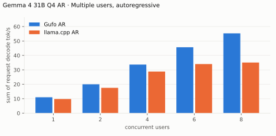

---

<!-- bench:multi-ar-q8 -->
| Gemma 4 31B Q8 AR Users | Gufo AR (tok/s) | llama.cpp AR (tok/s) | Gain |
| ---: | ---: | ---: | ---: |
| 1 | 6.36 | 5.84 | +8.9% |
| 2 | 11.91 | 11.04 | +7.9% |
<!-- /bench -->

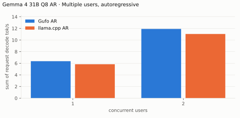

## Multiple users, MTP

Same pp2048 mixed/repetitive prompts as single-user d0, tg128, context 4096
per user. All sessions prefilled before timed decoding; rates sum individual
request decode rates. C1 cross-checks the single-user table. Gufo verifies all
sessions' drafts in one forward of at most 16 rows (16 / users − 1 drafts per
session), which keeps each row's arithmetic equal to its own session's decode;
llama.cpp verifies up to 4 drafts per user with Q8_1-activation matrix kernels,
which scale further with rows. Gufo's lead from AR does not carry past two
users.

<!-- bench:multi-mtp -->
| Gemma 4 31B Q4 MTP Users | Gufo mixed (tok/s) | llama.cpp mixed (tok/s) | Gain | Gufo repetitive (tok/s) | llama.cpp repetitive (tok/s) | Gain |
| ---: | ---: | ---: | ---: | ---: | ---: | ---: |
| 1 | 26.62 | 20.73 | +28.4% | 116.54 | 30.93 | +276.8% |
| 2 | 43.83 | 32.25 | +35.9% | 125.09 | 49.44 | +153.0% |
| 4 | 67.85 | 48.28 | +40.5% | 118.75 | 75.05 | +58.2% |
| 6 | 80.97 | 58.11 | +39.3% | 130.09 | 99.65 | +30.5% |
| 8 | 81.95 | 57.05 | +43.6% | 102.64 | 87.82 | +16.9% |
<!-- /bench -->

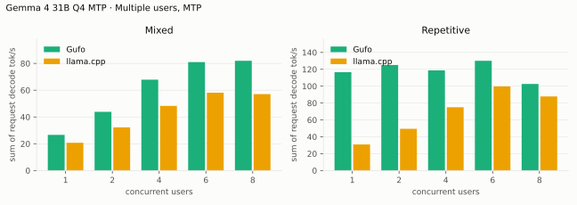

---

<!-- bench:multi-mtp-q8 -->
| Gemma 4 31B Q8 MTP Users | Gufo mixed (tok/s) | llama.cpp mixed (tok/s) | Gain | Gufo repetitive (tok/s) | llama.cpp repetitive (tok/s) | Gain |
| ---: | ---: | ---: | ---: | ---: | ---: | ---: |
| 1 | 15.51 | 13.43 | +15.5% | 61.69 | 22.28 | +176.9% |
| 2 | 25.60 | 22.62 | +13.2% | 64.32 | 38.23 | +68.2% |
<!-- /bench -->

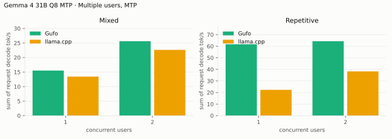

## MTP draft policy

`--draft-policy calibrated` became the default on September 28, 2026; the MTP
tables above use it. Relative A/B of the two policies on one development
build (`gpu-test` preset), two runs each in ABBA order with one server per
run; greedy texts are identical under both policies, sampled texts differ
because draft counts change the random draws. Depth is a shared earlier
conversation turn reused from the prompt cache.
[d0](artifacts/draft-policy-ab-d0k.json) · [8K](artifacts/draft-policy-ab-d8k.json) ·
`tools/gemma4/draft_policy_bench.py`

| Gemma 4 31B Q4 MTP Workload | d0 confidence (tok/s) | d0 calibrated (tok/s) | Gain | 8K confidence (tok/s) | 8K calibrated (tok/s) | Gain |
| --- | ---: | ---: | ---: | ---: | ---: | ---: |
| Prose, greedy (12 prompts) | 22.81 | 23.05 | +1.0% | 20.90 | 21.39 | +2.4% |
| Story, temperature 1 (12 seeds) | 19.87 | 20.02 | +0.8% | 19.49 | 19.24 | -1.3% |
| Code writing, greedy | 35.28 | 36.16 | +2.5% | 30.09 | 31.15 | +3.5% |
| Code writing, temperature 0.6 (12 seeds) | 27.82 | 28.00 | +0.7% | 25.79 | 26.03 | +0.9% |
| Code edit in context, greedy | 54.50 | 54.38 | -0.2% | 52.76 | 51.94 | -1.5% |
| Repetitive, greedy | 57.38 | 57.03 | -0.6% | 55.27 | 55.06 | -0.4% |

Prose and new code gain; verbatim copying is within about 1.5%. Per-run
values and draft counts are in the artifacts.

## Image requests

Single user, AR, context 16384. Each image was resized once to a
multiple of 48 so both servers encode identical pixels into the same soft
tokens: Gufo at `--image-tokens 280` or `1120`, llama.cpp with its default
70–1120 range. llama.cpp needs `-b 2048 -ub 2048` here: with the default
512-token ubatch it aborts on 1,107-token images (non-causal image batches
must fit one ubatch). Cold: a fresh nonce precedes the image, so nothing is
reused; follow-up: the next user turn, reusing the image prefix. Median of
three warmed requests, 64 output tokens, greedy
([Gufo 280](artifacts/image-gufo-280.json), [Gufo 1120](artifacts/image-gufo-1120.json),
[llama.cpp](artifacts/image-reference.json); `tools/gemma4/image_bench.py`).

| Image | Budget | Prompt tokens | Gufo cold TTFT (s) | llama.cpp cold TTFT (s) | Gain | Gufo follow-up TTFT (s) | llama.cpp follow-up TTFT (s) | Gain | Gufo tg (tok/s) | llama.cpp tg (tok/s) | Gain |
| --- | ---: | ---: | ---: | ---: | ---: | ---: | ---: | ---: | ---: | ---: | ---: |
| Chart 624×960 | 280 | 312 | 1.32 | 1.92 | +45.5% | 0.41 | 0.70 | +68.4% | 11.43 | 9.90 | +15.5% |
| Logo 768×768 | 280 | 309 | 1.30 | 1.85 | +42.4% | 0.41 | 0.72 | +75.9% | 11.43 | 9.54 | +19.8% |
| Chart 1296×1968 | 1120 | 1160 | 4.57 | 8.34 | +82.4% | 0.47 | 1.04 | +121.8% | 11.05 | 8.27 | +33.6% |
| Logo 1584×1584 | 1120 | 1140 | 4.34 | 8.35 | +92.4% | 0.48 | 1.10 | +126.3% | 11.04 | 7.96 | +38.7% |

Gain is llama.cpp time over Gufo time minus one (decode: Gufo over
llama.cpp). Gufo's vision encoder takes 162 ms for 260 soft tokens and
1,147 ms for 1,107; the rest of a cold request is ordinary prefill.

## Vulkan llama.cpp fork (single user)

A third-party baseline: the Strix Halo llama.cpp fork halo-box/strix-llama.cpp
`8c1c282ec` on Vulkan RADV with `GGML_VK_MMV_NO_SPLIT=1 -b 2048 -ub 512`, same
GGUF files, same driver workloads and four draft tokens (Gufo up to seven).
Hand-rendered from
[artifacts/fork](artifacts/fork); the Gufo cells here are from the
September 26 run (revision b3a13bc), not the refreshed tables above. At 128K with MTP its Vulkan queue timed out
(`Fence fallback timer expired on ring comp_1.1.0`); its repetitive MTP
workload was not run.

Greedy MTP texts differ between the engines, so accepted drafts per cycle
differ per depth; Gufo drafts up to seven tokens under its confidence-based
length control, the fork a fixed four. Gufo's cycle (draft plus verify) is
shorter at every measured depth: 117 vs 120 ms at d0, 118 vs 126 ms at 4K,
132 vs 165 ms at 32K and 159 vs 211 ms at 64K.

| Gemma 4 31B Q4 AR Depth (tokens) | Gufo pp (tok/s) | fork pp (tok/s) | Gain | Gufo tg (tok/s) | fork tg (tok/s) | Gain |
| ---: | ---: | ---: | ---: | ---: | ---: | ---: |
| 0 | 427.05 | 293.92 | +45.3% | 10.73 | 10.53 | +1.9% |
| 4,096 | 390.56 | 259.83 | +50.3% | 10.60 | 10.29 | +3.0% |
| 8,192 | 368.90 | 243.79 | +51.3% | 10.46 | 10.01 | +4.5% |
| 12,288 | 345.49 | 220.65 | +56.6% | 10.37 | 9.87 | +5.1% |
| 16,384 | 343.90 | 211.76 | +62.4% | 10.24 | 9.58 | +6.9% |
| 32,768 | 294.07 | 164.54 | +78.7% | 9.81 | 8.93 | +9.9% |
| 65,536 | 225.69 | 117.97 | +91.3% | 9.07 | 7.74 | +17.2% |
| 131,072 | 156.09 | 74.00 | +110.9% | 7.84 | 6.10 | +28.5% |

---

\* Gufo cells measured with the previous `--draft-policy confidence` default; see [MTP draft policy](#mtp-draft-policy) for the calibrated default at d0 and 8K.

| Gemma 4 31B Q4 MTP mixed Depth (tokens) | Gufo pp (tok/s) | fork pp (tok/s) | Gain | Gufo tg (tok/s) | fork tg (tok/s) | Gain | Gufo / fork accepted per cycle |
| ---: | ---: | ---: | ---: | ---: | ---: | ---: | ---: |
| 0 | 418.34 | 286.71 | +45.9% | 23.19 | 21.71 | +6.8% | 1.72 / 1.61 |
| 4,096 | 394.89 | 253.75 | +55.6% | 23.49 | 23.17 | +1.4% | 1.78 / 1.91 |
| 8,192 | 373.51 | 234.69 | +59.2% | 22.25 | 20.84 | +6.8% | 1.67 / 1.78 |
| 12,288 | 356.43 | 216.64 | +64.5% | 21.53 | 17.49 | +23.1% | 1.61 / 1.37 |
| 16,384 | 347.03 | 201.12 | +72.5% | 21.65 | 19.42 | +11.5% | 1.72 / 1.72 |
| 32,768 | 298.45 | 159.66 | +86.9% | 21.00 | 16.47 | +27.5% | 1.78 / 1.72 |
| 65,536 | 229.88 | 114.11 | +101.5% | 15.83 | 12.67 | +24.9% | 1.51 / 1.67 |
| 131,072 | 161.09 | N/A | N/A | 12.73 | N/A | N/A | 1.51 / N/A |

## Loading time

C1, capacity 262144, MTP. Cold model files to HTTP readiness, with no vision
sidecar beside the target. With `mmproj-BF16.gguf` beside it Gufo also
prepares the vision encoder at load: about 0.7 s more.

<!-- bench:loading -->
| Gemma 4 31B Target | Gufo ready (s) | llama.cpp ready (s) | Gain |
| --- | ---: | ---: | ---: |
| Q4 | 4.34 | 6.58 | +51.6% |
| Q8 | 7.11 | 10.27 | +44.4% |
<!-- /bench -->

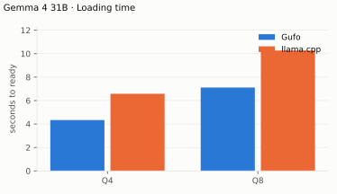

## Memory occupation

Capacity 133121 tokens, AR. Both engines allocate KV for the whole capacity.
The counter is device total minus free, which on this unified-memory APU
tracks system-wide use; Gufo (October 17) and llama.cpp (September 27) start
from the same 3.0 GiB idle baseline. No vision sidecar is loaded; with
`mmproj-BF16.gguf` beside the target Gufo holds 2.4 GiB more for the
prepared vision encoder. Gufo's figure includes its prompt cache:
after the cold 16K prefix it holds about 7 GB of snapshots (a checkpoint
every 2,048 tokens of a cold prompt, the stable conversation boundary and the
complete prompt, sharing the position blocks they have in common), bounded by the snapshot cache and released under memory
pressure. llama.cpp runs with `--cache-ram 0`.
Gufo's global layers store V and only the rotated key dims (50 KiB per
token instead of 80).

<!-- bench:memory -->
| Gemma 4 31B Q4 AR Workload | Gufo GiB | llama.cpp GiB | Gain |
| --- | ---: | ---: | ---: |
| pp2048 + tg128 | 32.49 | 35.47 | +9.2% |
| 16K prefix, pp4096 + tg128 | 39.05 | 37.64 | -3.6% |
<!-- /bench -->

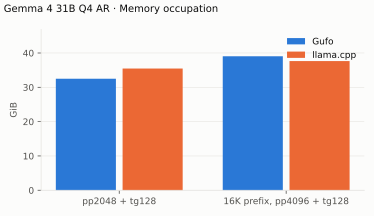

---

<!-- bench:memory-q8 -->
| Gemma 4 31B Q8 AR Workload | Gufo GiB | llama.cpp GiB | Gain |
| --- | ---: | ---: | ---: |
| pp2048 + tg128 | 47.55 | 50.79 | +6.8% |
| 16K prefix, pp4096 + tg128 | 54.11 | 52.96 | -2.1% |
<!-- /bench -->

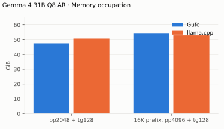

## Verification attention kernel A/B (2026-10-19)

The foldable DPP reductions compared with 04d70a14 on gfx1151, using
production arithmetic flags. Full attention launch including merge; medians
of seven alternating A/B rounds. Every output is byte-identical, including
queries scaled 10× and 30×. These are per-layer kernel times.

| Context | Rows | Before (µs) | After (µs) | Time change |
| ---: | ---: | ---: | ---: | ---: |
| 32,768 | 5 | 1749.5 | 1685.2 | -3.7% |
| 32,768 | 8 | 2566.3 | 2415.1 | -5.9% |
| 32,768 | 16 | 4939.0 | 4629.7 | -6.3% |
| 65,536 | 5 | 3401.7 | 3267.9 | -3.9% |
| 65,536 | 8 | 5033.9 | 4717.6 | -6.3% |
| 65,536 | 16 | 10046.1 | 9405.4 | -6.4% |

[Every row, depth, timing round and calibrated cost delta](artifacts/mtp-verification-2026-10-19.json).

The production C1 check includes the calibrated cost tables. Native
`gufo bench` pp2048/tg128 at d0, in ABBA order (tok/s):

| Phase | Baseline 1 | Candidate 1 | Candidate 2 | Baseline 2 |
| --- | ---: | ---: | ---: | ---: |
| pp2048 | 575.85 | 574.21 | 575.11 | 575.23 |
| tg128 | 31.38 | 31.43 | 31.42 | 31.37 |

HTTP, two 400-token greedy answers about a frozen repository document, four
fresh servers in ABBA order. Input is 31,290 tokens for the summary and
31,297 for the essay; the latter restores the same 22,528-token prefix on
every arm. Both completions are identical across every run. Throughput is
decode-only, with the means calculated separately for each question:

| Request | Baseline 1 / 2 (tok/s) | Candidate 1 / 2 (tok/s) | Decode gain |
| --- | ---: | ---: | ---: |
| summary | 23.41 / 23.39 | 23.63 / 23.68 | +1.1% |
| essay | 20.44 / 20.44 | 20.62 / 20.61 | +0.8% |

The first pair saves about 164 ms of decode on each answer. Cold summary
prefill still takes 66–67 s and essay prefill about 21 s; these runs establish
a decode gain, with little effect on total cold-request latency. Each
request’s prefill/decode timing passes the 5% and 3 ms comparison; the raw
usage, actual draft counts and output hashes are retained with the kernel
evidence. This is a focused Gufo comparison against 04d70a14; the reference
server tables above retain their original measurement dates.

## MTP attention, depth ABBA (2026-10-20)

UD-Q4_K_XL, production `release` binaries: `519dfe9c` (same source as
`eb17a526`) against `422fbe4d`, including the recalibrated draft costs.
Greedy, seed 1; fresh processes in baseline/candidate/candidate/baseline
order. Rates below are decode-only or prefill-only, as labeled; gains use
the two rates' means. Each request/phase is checked separately at 5% and
3 ms in the artifact.

Native `gufo bench -p 2048 -n 128 -d 16384,32768 -r 1 --verbose`.
Prefill and decode are separate measurements; depth preparation is untimed.
The synthetic repetitive decode exercises wide verification and prompt lookup.

| Gemma 4 31B UD-Q4_K_XL MTP Depth (tokens) | Phase | Baseline 1 / 2 (tok/s) | Candidate 1 / 2 (tok/s) | Gain |
| ---: | --- | ---: | ---: | ---: |
| 16,384 | pp2048 | 472.08 / 454.50 | 454.24 / 454.47 | -1.9% |
| 16,384 | tg128 | 99.61 / 97.42 | 105.64 / 105.57 | +7.2% |
| 32,768 | pp2048 | 392.43 / 392.45 | 392.17 / 392.40 | -0.0% |
| 32,768 | tg128 | 87.36 / 87.43 | 86.99 / 86.90 | -0.5% |

HTTP C1, context 40960, one short warmup per fresh server. Default-policy
summary and essay: the original frozen ~31K-token document, 400 output
tokens each. The code edit renames a dataclass in a supplied module after
an archive of similar depth (512 output tokens). A separate fixed-policy
11-draft control warms that shape with 128 output tokens, then repeats the
same prompt for 512; the cap exercises the 9–12-row launch range with ragged lookup/tail rows.

| Gemma 4 31B UD-Q4_K_XL MTP Request | Baseline 1 / 2 (tok/s) | Candidate 1 / 2 (tok/s) | Gain |
| --- | ---: | ---: | ---: |
| Summary, default | 23.64 / 23.66 | 23.67 / 23.67 | +0.1% |
| Essay, default | 20.34 / 20.35 | 20.64 / 20.65 | +1.5% |
| Code edit, default | 75.97 / 75.99 | 77.43 / 77.44 | +1.9% |
| Code edit, fixed 11 drafts | 62.51 / 62.53 | 63.55 / 63.52 | +1.6% |

[All rounds, counts, hashes, timings and phase verdicts](artifacts/mtp-attention-e2e-2026-10-20.json).

All HTTP texts and token/cache counts match across the four arms. Default
code edit uses the same 41 cycles, 537 proposals and 470 accepted proposals
on every arm. The 11-draft control uses 55 cycles and 489 proposals, including
ragged lookup/tail rows. Its gain is below the 5% timing threshold.

The native 16K decode gain passes both paired 5% / 3 ms checks; 32K decode
is neutral. At 16K the candidate uses eight cycles rather than nine. At 32K
both use nine, but neural proposals increase from 10 to 16 while lookup
copies fall from 108 to 105, with the same 118 accepted proposals.

Default HTTP whole-request latency changes by less than 1%: summary
83.97 → 84.00 s, essay 40.92 → 40.63 s, code edit 27.81 → 27.68 s.
Every paired prefill, decode, TTFT and whole-request comparison remains
within 5% / 3 ms. **The essay maximum inter-token gap fails that check:**
154.02 / 153.92 → 167.80 / 167.33 ms. Summary/code snapshot timings have
mixed flags and remain inconclusive. This does not establish an overall
latency improvement. The historical llama.cpp tables retain their original
measurements.

A separate cost-only ABBA keeps the new kernel and restores the previous
31B verification prices in a diagnostic binary. Summary/essay schedules
return to baseline (602 proposals / 117 cycles; 554 / 144). Essay maximum
gap is 152.36 / 152.48 ms against matched baselines 152.10 / 153.94 ms;
its decode gain is +0.5%, below threshold. This supports a pricing-driven
throughput/pause tradeoff in the original candidate. The diagnostic summary
snapshot timer flags slower in both pairs, but its 97.45–97.84 ms falls
inside the 86.56–99.49 ms spread of four unchanged-baseline controls for
identical snapshot bytes; attribution remains inconclusive. All observations
are retained separately from the `422fbe4d` results; implementation is unchanged.

A per-cycle trace of both price tables in one binary explains the essay gap
([every cycle](artifacts/mtp-cycle-trace-2026-10-20.json)). At position
31463 both draft the same seven tokens; the new prices then add two
siblings, verify 10 rows in 164.9 / 167.4 ms and emit two tokens, where the
old prices verify 8 rows in 152.1 / 152.3 ms and emit one. Every other
essay cycle stays at or below ~152.7 ms. The larger maximum gap is one
cycle delivering an extra token earlier, not a longer pause per token.

The October 20 paired-head wave64 experiment did not establish an end-to-end
gain. Its selected global-verification shapes improve in isolation, while
other widths regress; the narrow HTTP dispatch has only inconclusive
−0.7 to +0.3% per-request decode-rate changes across 31B and 26B. The
production tables above remain unchanged. See the
[experiment evidence](artifacts/wave64-global-verification-2026-10-20.json).
The standard C1 MTP control at d16384 (one repetition per arm) reports
pp2048 473.13 → 454.43 tok/s and tg128 98.84 → 98.66 tok/s. This single pair
is inconclusive and does not replace the qualified benchmark tables.
