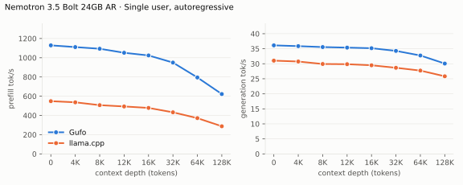
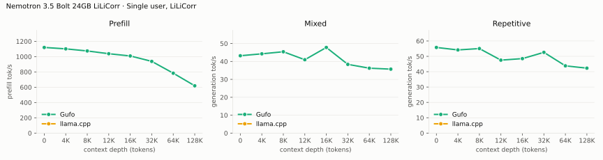
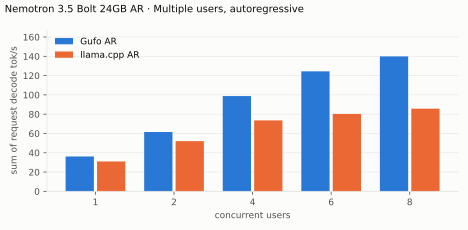
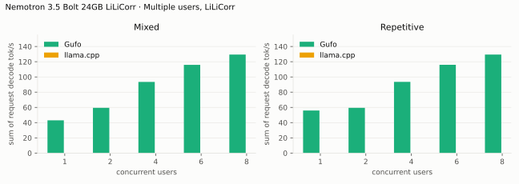
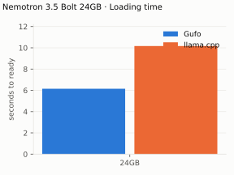
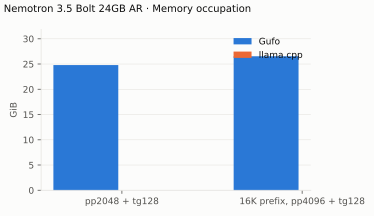

# Nemotron 3.5 Bolt 74B-A9B benchmarks

AMD Strix Halo `gfx1151`, 128 GB unified memory, package power limit about
140 W. NVIDIA's 24GB GGUF with its LiLiCorr drafter; both engines draft up
to 7 tokens per round. HTTP, greedy, thinking off. Gufo `release` build with
ROCm 10.1; llama.cpp `c3df4b7e2`, Vulkan (October 30, 2026). Positive gain
favors Gufo.
[Quality and measurement details](QUALITY.md#benchmark-method) · [Model identities](artifacts/model-identities.json)

## Single user, autoregressive

pp2048 / tg128; depth is the cached prefix in tokens.

<!-- bench:single-ar -->
| Nemotron 3.5 Bolt 24GB AR Depth (tokens) | Gufo pp (tok/s) | llama.cpp pp (tok/s) | Gain | Gufo tg (tok/s) | llama.cpp tg (tok/s) | Gain |
| ---: | ---: | ---: | ---: | ---: | ---: | ---: |
| 0 | 1128.85 | 548.39 | +105.8% | 36.13 | 31.04 | +16.4% |
| 4,096 | 1110.81 | 536.55 | +107.0% | 35.87 | 30.75 | +16.7% |
| 8,192 | 1093.48 | 507.03 | +115.7% | 35.56 | 29.93 | +18.8% |
| 12,288 | 1051.68 | 493.50 | +113.1% | 35.38 | 29.86 | +18.5% |
| 16,384 | 1023.97 | 478.30 | +114.1% | 35.18 | 29.50 | +19.3% |
| 32,768 | 949.66 | 432.60 | +119.5% | 34.29 | 28.67 | +19.6% |
| 65,536 | 794.95 | 372.06 | +113.7% | 32.75 | 27.73 | +18.1% |
| 131,072 | 622.42 | 287.39 | +116.6% | 30.07 | 25.83 | +16.4% |
<!-- /bench -->

## Single user, LiLiCorr

pp is the highest measured rate per depth across mixed/repetitive text.
Gufo's completions equal its autoregressive ones at every depth. llama.cpp's
`draft-dflash` output differs from its own autoregressive output, so its
cells are N/A.

<!-- bench:single-lilicorr -->
| Nemotron 3.5 Bolt 24GB LiLiCorr Depth (tokens) | Gufo pp (tok/s) | llama.cpp pp (tok/s) | Gain pp | Gufo tg mixed (tok/s) | llama.cpp tg mixed (tok/s) | Gain mixed | Gufo tg repetitive (tok/s) | llama.cpp tg repetitive (tok/s) | Gain repetitive |
| ---: | ---: | ---: | ---: | ---: | ---: | ---: | ---: | ---: | ---: |
| 0 | 1120.22 | N/A | N/A | 43.20 | N/A | N/A | 55.79 | N/A | N/A |
| 4,096 | 1101.77 | N/A | N/A | 44.26 | N/A | N/A | 54.17 | N/A | N/A |
| 8,192 | 1074.44 | N/A | N/A | 45.42 | N/A | N/A | 55.06 | N/A | N/A |
| 12,288 | 1038.19 | N/A | N/A | 40.96 | N/A | N/A | 47.52 | N/A | N/A |
| 16,384 | 1008.97 | N/A | N/A | 47.82 | N/A | N/A | 48.52 | N/A | N/A |
| 32,768 | 938.00 | N/A | N/A | 38.37 | N/A | N/A | 52.60 | N/A | N/A |
| 65,536 | 783.59 | N/A | N/A | 36.24 | N/A | N/A | 43.81 | N/A | N/A |
| 131,072 | 618.71 | N/A | N/A | 35.71 | N/A | N/A | 42.30 | N/A | N/A |
<!-- /bench -->

## Multiple users, autoregressive

Same pp2048 prose prompt as single-user d0, tg128, context 4096 per user.
All sessions prefilled before timed decoding; throughput sums individual
rates.

<!-- bench:multi-ar -->
| Nemotron 3.5 Bolt 24GB AR Users | Gufo AR (tok/s) | llama.cpp AR (tok/s) | Gain |
| ---: | ---: | ---: | ---: |
| 1 | 36.16 | 31.01 | +16.6% |
| 2 | 61.53 | 52.06 | +18.2% |
| 4 | 98.82 | 73.57 | +34.3% |
| 6 | 124.40 | 80.28 | +55.0% |
| 8 | 139.93 | 85.71 | +63.3% |
<!-- /bench -->

## Multiple users, LiLiCorr

Same pp2048 mixed/repetitive prompts as single-user d0, tg128, context 4096
per user. All sessions prefilled before timed decoding; rates sum individual
request decode rates. Gufo drafts while a request decodes alone; concurrent
requests share a pass of one token each. llama.cpp is N/A as above.

<!-- bench:multi-lilicorr -->
| Nemotron 3.5 Bolt 24GB LiLiCorr Users | Gufo mixed (tok/s) | llama.cpp mixed (tok/s) | Gain | Gufo repetitive (tok/s) | llama.cpp repetitive (tok/s) | Gain |
| ---: | ---: | ---: | ---: | ---: | ---: | ---: |
| 1 | 43.03 | N/A | N/A | 55.92 | N/A | N/A |
| 2 | 59.42 | N/A | N/A | 59.42 | N/A | N/A |
| 4 | 93.49 | N/A | N/A | 93.52 | N/A | N/A |
| 6 | 115.92 | N/A | N/A | 115.96 | N/A | N/A |
| 8 | 129.41 | N/A | N/A | 129.41 | N/A | N/A |
<!-- /bench -->

## Loading time

C1, context capacity 262144, LiLiCorr. Cold target/drafter files to HTTP
readiness.

<!-- bench:loading -->
| Nemotron 3.5 Bolt 24GB Target | Gufo ready (s) | llama.cpp ready (s) | Gain |
| --- | ---: | ---: | ---: |
| 24GB | 6.15 | 10.17 | +65.4% |
<!-- /bench -->

## Memory occupation

C1, context capacity 133121, autoregressive. Peak memory reported by HIP;
the Vulkan reference allocates outside HIP.

<!-- bench:memory -->
| Nemotron 3.5 Bolt 24GB AR Workload | Gufo GiB | llama.cpp GiB | Gain |
| --- | ---: | ---: | ---: |
| pp2048 + tg128 | 24.79 | N/A | N/A |
| 16K prefix, pp4096 + tg128 | 26.54 | N/A | N/A |
<!-- /bench -->

