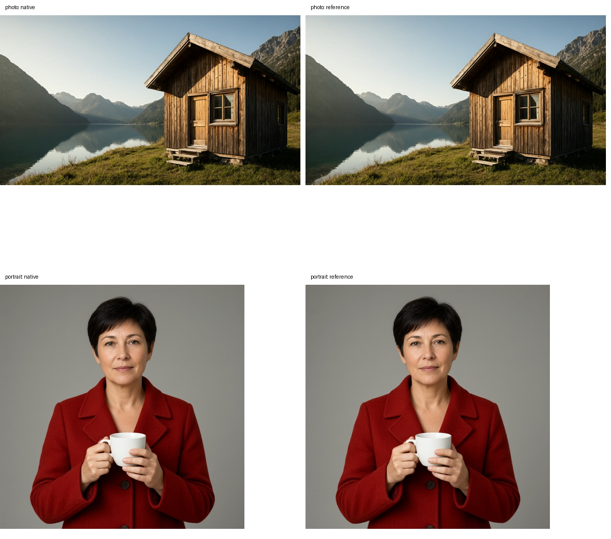
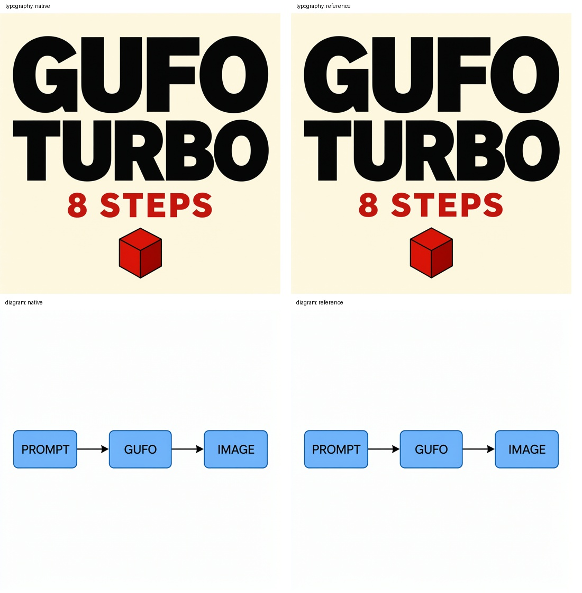
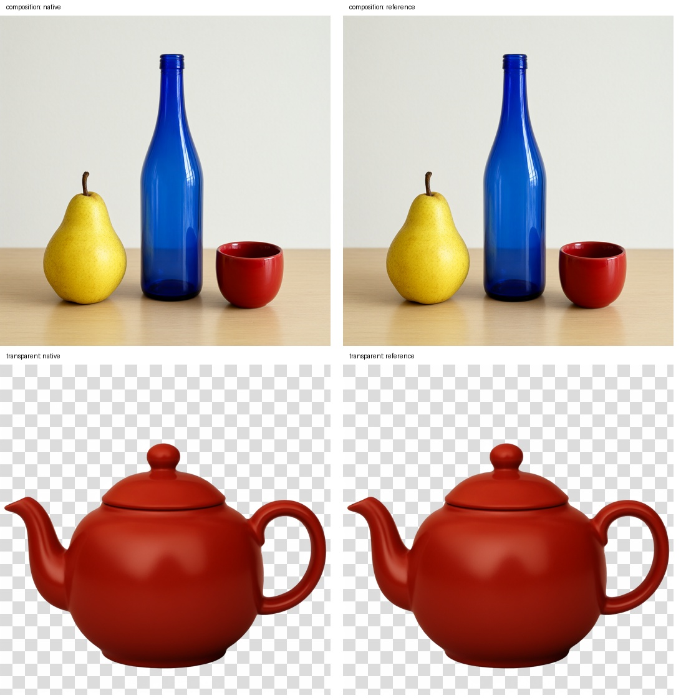
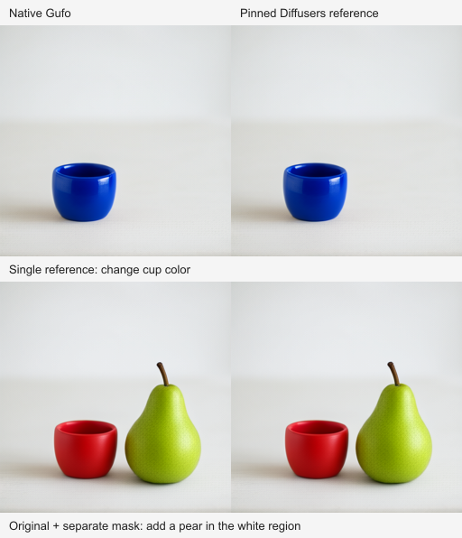

# Qwen-Image-2.1-Turbo generation and editing

This fork adds native BF16 Turbo **generation and editing** on gfx1151.
Turbo uses the existing ordered-reference, vision-conditioning and RGBA VAE
paths with its trained eight-step schedule. It accepts up to ten references,
including colored guidance or an original-plus-mask pair. This work tracks upstream [issue #689](https://github.com/gufo-org/gufo/issues/689).

## Pinned model contract

Download the runtime pipeline (approximately 32.5 GB, not bundled):

```sh
hf download Qwen/Qwen-Image-2.1-Turbo \
  --revision fc13ba1986fcb905854dc8de2f52eee395f49b5b \
  --exclude 'assets/*' --local-dir "$HOME/models/Qwen-Image-2.1-Turbo"
```

The transformer architecture, prompt encoder and RGBA VAE use the existing
native BF16 operators. The trained Turbo transformer is different from the base
transformer. Its pipeline metadata supplies these sampling sigmas:

```text
1.0, 0.978453, 0.95418, 0.926626, 0.89508, 0.845148, 0.704534, 0.414568
```

The scheduler has `shift=1`, `use_dynamic_shifting=false`, and
`shift_terminal=null`. Gufo converts the supplied values to FP32, appends zero,
and performs eight Euler updates without the base checkpoint's dynamic shift or
terminal stretching. Invalid or inconsistent sampling metadata is rejected.
Model identity comes from its configuration, not the directory or served name.
The loader accepts the official unsharded prompt encoder and nested
`processor_config.json`, while preserving the base checkpoint's sharded encoder
and legacy processor configuration. The Turbo VAE is stored in BF16; native
arithmetic retains the existing BF16 and FP32 accumulation boundaries.

## Build and install a separate service

Build this fork with its pinned Nix toolchain on Linux x86-64. The image build
uses the default qualified ROCm 7.2.3 configuration:

```sh
nix build --impure --file .devops/nix/image.nix \
  --argstr source "$PWD" --argstr revision "$(git rev-parse HEAD)" \
  --out-link result-turbo-image
podman load -i result-turbo-image
image_id=$(podman image inspect "localhost/gufo-image-turbo:$(git rev-parse --short=12 HEAD)" --format '{{.Id}}')
python3 -m venv "$HOME/.local/share/gufo-image-client"
"$HOME/.local/share/gufo-image-client/bin/python" -m pip install Pillow==13.0.0
python3 tools/models/qwen_image_21/install_turbo.py \
  --image "$image_id" --python "$HOME/.local/share/gufo-image-client/bin/python"
```

Reuse an existing Pillow environment when available. Run the installer as the
ordinary GPU-enabled user. It installs `gufo-turbo`, `gufo-image-turbo` and a
disabled user service, with an immutable local image ID. It does not change the
existing `gufo` command or base-model service. Podman requires `crun`, GPU-device
access and supplementary-group preservation as described in the main README.

```sh
systemctl --user start gufo-image-turbo.service
~/.local/bin/gufo-image-turbo --prompt 'A timber cabin beside an alpine lake at sunrise' \
  --size 1920x1080 --seed 42 --output "$HOME/turbo.png"
systemctl --user stop gufo-image-turbo.service
```

The helper preserves the native PNG and writes an exactly sized cropped PNG
plus JSON timings. Stop the Turbo service to release model memory; the base
model remains separately available.

## API

```sh
gufo-turbo serve --host 127.0.0.1 --port 28182 image \
  --model "$HOME/models/Qwen-Image-2.1-Turbo" --served-model-name Qwen-Image-2.1-Turbo
curl --fail-with-body http://127.0.0.1:28182/v1/images/generations \
  -H 'Content-Type: application/json' \
  -d '{"model":"Qwen-Image-2.1-Turbo","prompt":"A red ceramic teapot on a wooden table", "size":"1024x1024","seed":42}'
```

Editing uses the same multipart endpoint and controls as the base model:

```sh
~/.local/bin/gufo-image-turbo --reference original.png \
  --prompt 'Change the cup to cobalt blue, preserving its shape and lighting.' \
  --size 1024x1024 --seed 42 --output edited.png

~/.local/bin/gufo-image-turbo --reference original.png --reference mask.png \
  --prompt 'Use image 1 as the original and image 2 as a separate black-and-white mask. Add a green pear in the white editable area. Remove mask and guidance marks.' \
  --size 1024x1024 --seed 42 --output masked-edit.png
```

Use repeated multipart `image[]` fields with `/v1/images/edits` for ordered
references. Seeds, `n`, size, transparent/opaque backgrounds, and PNG responses
use the existing image API. Masks are guidance supplied as another reference;
the server returns the complete generated image without compositing original
pixels outside the mask.

Omit `steps` or pass `8`. Other step counts return HTTP 400 rather than silently
using an unqualified schedule. The base model retains its default 40 steps and
2–100 range. Seeds, PNG/base64 responses, serial independent outputs, dimensions
and background settings follow the [existing image API](README.md). There is no
custom-sigma HTTP parameter. Gufo and PyTorch use different RNGs; compare actual
initial noise tensors, not equal numeric seeds.

1920×1080 is not divisible by 32: request 1920×1088 and center-crop four pixels
from the top and bottom for an exact 1920×1080 deliverable.

The separate model weights retain the non-commercial Qwen Research License.
The fork's code retains Gufo's license. Turbo quality and speed must be measured
separately from the original model; eight steps on the original weights are not
Turbo.

## Qualification

Use the model's existing CPU tests, GPU operator tests and native probe. The
probe and independent reference accept `--width`/`--height` for rectangular
trajectories. Use a Diffusers revision with checkpoint-configured
`sample_sigmas`, pinned to `aaf57d03a3edfbd9de457d2872417a92f149a91d` for this
qualification, alongside recorded Torch/Transformers versions. Run eight steps
with shared initial noise, exact schedule comparison, matched-block numerical
checks and complete decoded trajectories. Keep tensor dumps and private
deployment logs outside Git.

The retained oracle uses Torch 2.12.0/ROCm 7.2, Transformers 5.17.0,
Hugging Face Hub 1.32.0, Tokenizers 0.23.1 and Safetensors 0.8.0. Supply
`--model-revision` and `--diffusers-revision` to the reference tool when recording
source-checkout runs. Runtime dependencies stay outside the native engine.

## Measured qualification — 25 October 2026

The generation path is qualified at engine commit `5388d5d5af2b6c117657e6f5a3e711b73e94c5fb`. Both desktops use
the same immutable image `sha256:fbb4437858d53105c074fc11d81198c3082dbd942fa676a3a50ac44a0b433435` and verified checkpoint.
The [machine-readable evidence](artifacts/turbo-qualification.json) and
[model manifest](artifacts/turbo-model-manifest.json) retain exact revisions,
per-request times and image hashes.

Three alternating paired repetitions per desktop, with seeds 42, 43 and 44:

| Desktop | Base, 40 steps | Turbo, 8 steps | Latency speedup |
| --- | ---: | ---: | ---: |
| Desktop 1 | 244.92 s | 50.46 s | 4.854× |
| Desktop 2 | 234.73 s | 49.75 s | 4.719× |

Each timed output is exactly **1920×1080**, rendered at 1920×1088 and center-cropped.
Times include HTTP inference, PNG handling, crop and save; model/container loading
and explicit warmups are excluded. Both controls use the same pinned compiler,
ROCm and packaging. Base uses its original weights and 40 steps; Turbo uses its
separate trained weights and eight steps. Results cover one performance prompt,
not a broad performance corpus.

Native phase medians and resident weight buffers:

| Mode | Prompt ms | Denoising s | VAE s | Resident weights GiB |
| --- | ---: | ---: | ---: | ---: |
| Desktop 1 base | 89.2 | 242.96 | 1.56 | 27.82 |
| Desktop 1 turbo | 88.2 | 48.48 | 1.56 | 27.82 |
| Desktop 2 base | 87.7 | 232.77 | 1.54 | 27.82 |
| Desktop 2 turbo | 87.6 | 47.80 | 1.54 | 27.82 |

The native engine reports the same resident weight footprint in both modes.
Total working memory additionally includes activations, scratch and mapped files;
the driver-reported VRAM counter is retained separately in the evidence.

Two independent Turbo workers completed a pair in a median
**49.49 s**, versus
**101.81 s** sequentially on one desktop:
**2.057× throughput**. All six paired seeds replayed
exactly, including cross-desktop renders. Image inference stays on each desktop;
the connected USB4 links do not split one image across GPUs. RDMA byte counters
did not change during measured requests.

The independent oracle uses the pinned official Diffusers source and **shared
initial noise tensors**. All nine FP32 schedule values match exactly.
All 313 checks with matched inputs pass the 1% relative-L2 contract;
the worst was 0.003111. Six complete generation comparisons
cover photography, portraits/hands, typography, diagrams, object layout and alpha
transparency. Their full-trajectory latent cosine ranges from
0.999284 to
0.999971; PNG PSNR ranges from
32.86 to 48.68 dB.
Visual inspection found matching content and layout, with small detail differences.
BF16 reduction order produces different pixels across runtimes; these checks do
not establish aesthetic parity with the base model. Base generation and editing
replay pixel-for-pixel against upstream in the retained controls.

Both hosts pass real HTTP generation, checkpoint-default steps, explicit eight
steps, serial `n=2`, concurrent queued requests, resizing, seed replay after
restart, invalid-request rejection and disconnect recovery. Kernel checks found
no GPU reset, hang or page fault during qualification and measurements.





## Editing qualification (2026-10-26)

The editing-qualified engine is `c5bad09cef01a5eb3a515cf7f4afc4a498910834`,
with immutable image ID
`b0ae766e2ee81a5e081de6b951d8d8fd44e3138809443510ef4f8cf2eb90150e`.
The existing GPU pipeline handles references; this change removes the two
Turbo-specific rejections at the HTTP and native-model boundaries. Sampling,
precision, reference preprocessing, seed binding and cache isolation retain
their existing formulas.

- All **346 matched-input checks** passed the existing **1% relative-L2**
  limit; the largest measured value was **0.004788**. All nine FP32 schedule
  values match the pinned official Diffusers pipeline exactly.
- A single-reference 256² full trajectory measured final-latent cosine
  **0.999965** and decoded PNG PSNR **53.44 dB** against the independent
  reference using the same initial noise. An original-plus-mask trajectory
  measured **0.999829** and **40.62 dB**.
- Real API requests passed for colored annotation editing, an original plus
  mask, two-reference composition, transparent extraction, a two-prompt batch,
  and 1920×1080 editing with retained native 1920×1088 pixels.
- Annotation and mask fixed-seed replays match decoded pixels exactly; mask
  replay also passed after service restart. The pre-upgrade generation sample
  and retained base-model mask control both replay pixel-for-pixel.
- Model/API contracts cover omitted and explicit eight steps, ordered RGBA
  references, two outputs, transparency, ten references, and rejection of an
  empty reference list, eleven references and invalid Turbo step counts.
  The shared C++ formatting check passed on 665 files. The consuming app's
  188 tests, type checks and production build passed.

These editing checks are recorded separately from the earlier generation
performance measurements above. The numerical comparisons use Torch 2.12.0,
Transformers 5.17.0 and the pinned Diffusers revision. They verify the native
implementation against the Turbo reference, rather than equating it with the
base checkpoint's image quality.

[Machine-readable editing qualification](artifacts/turbo-editing-qualification.json)

Reproduction fixtures: [original image](artifacts/turbo-editing-input.png) and
[separate mask](artifacts/turbo-editing-mask.png). The qualification JSON records
their SHA-256 hashes, exact prompts, native seed, dimensions and step count.
Use the probe’s positional image plus repeated `--image` arguments, then pass
the same ordered `--image` arguments to `reference.py` using the probe’s saved
`noise.f32`.


