# Qwen27B benchmarks

AMD Strix Halo `gfx1151`, 128 GB unified memory. Gufo versus llama.cpp
`b11069`, using the same Q4_K_XL / Q8_K_XL targets and Q4_K_M DFlash2 draft.
Gufo uses its adaptive controller. HTTP, greedy, thinking off.

All Gufo rows were refreshed October 19, 2026 on `11813e51` (wave64
verification attention, rebased on main `23fd87dc`). DFlash2 completions match
the earlier October 19 rows at every depth; decode gains grow with depth.
AR pp, multi-user rates and memory match matched main controls; their changes
from September predate this revision. All llama.cpp measurements are unchanged.

Positive gain favors Gufo.
[Quality and measurement details](QUALITY.md) · [Model identities](artifacts/model-identities.json)

## Single user, autoregressive

Approximately pp2048 / tg128; depth is the cached prefix in tokens.

<!-- bench:single-ar-q4 -->
| Qwen27B Q4 AR Depth (tokens) | Gufo pp (tok/s) | llama.cpp pp (tok/s) | Gain | Gufo tg (tok/s) | llama.cpp tg (tok/s) | Gain |
| ---: | ---: | ---: | ---: | ---: | ---: | ---: |
| 0 | 648.89 | 357.54 | +81.5% | 12.37 | 12.06 | +2.6% |
| 4,096 | 608.70 | 330.42 | +84.2% | 12.20 | 11.88 | +2.7% |
| 8,192 | 586.09 | 316.09 | +85.4% | 12.03 | 11.73 | +2.6% |
| 12,288 | 565.92 | 302.54 | +87.1% | 11.87 | 11.59 | +2.4% |
| 16,384 | 546.20 | 290.23 | +88.2% | 11.71 | 11.44 | +2.4% |
| 32,768 | 469.28 | 246.97 | +90.0% | 11.13 | 10.89 | +2.2% |
| 65,536 | 342.31 | 193.61 | +76.8% | 10.07 | 9.93 | +1.4% |
| 131,072 | 259.73 | 135.95 | +91.0% | 8.51 | 8.46 | +0.6% |
<!-- /bench -->

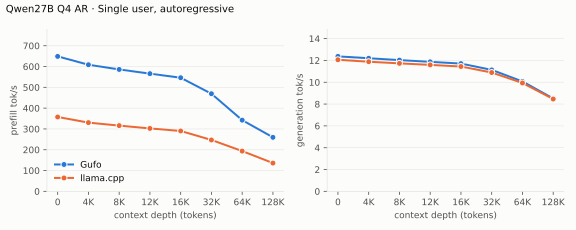

---

<!-- bench:single-ar-q8 -->
| Qwen27B Q8 AR Depth (tokens) | Gufo pp (tok/s) | llama.cpp pp (tok/s) | Gain | Gufo tg (tok/s) | llama.cpp tg (tok/s) | Gain |
| ---: | ---: | ---: | ---: | ---: | ---: | ---: |
| 0 | 479.25 | 337.08 | +42.2% | 7.19 | 7.20 | -0.1% |
| 4,096 | 463.03 | 317.96 | +45.6% | 7.14 | 7.14 | +0.0% |
| 8,192 | 451.42 | 306.22 | +47.4% | 7.08 | 7.08 | +0.0% |
| 12,288 | 426.61 | 289.19 | +47.5% | 7.01 | 7.02 | -0.1% |
| 16,384 | 407.95 | 276.91 | +47.3% | 6.95 | 6.97 | -0.3% |
| 32,768 | 363.22 | 236.32 | +53.7% | 6.76 | 6.76 | +0.0% |
| 65,536 | 293.26 | 186.67 | +57.1% | 6.37 | 6.38 | -0.2% |
| 131,072 | 228.10 | 133.34 | +71.1% | 5.72 | 5.74 | -0.3% |
<!-- /bench -->

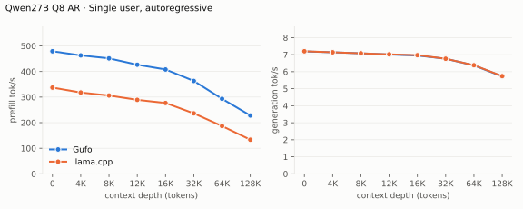

## Single user, DFlash2

pp is the highest measured rate per engine and depth across mixed/repetitive
text. Output-consistency controls and their dated scope are recorded in
the [quality details](QUALITY.md#meaning-of-exact).

<!-- bench:single-dflash2-q4 -->
| Qwen27B Q4 DFlash2 Depth (tokens) | Gufo pp (tok/s) | llama.cpp pp (tok/s) | Gain pp | Gufo tg mixed (tok/s) | llama.cpp tg mixed (tok/s) | Gain mixed | Gufo tg repetitive (tok/s) | llama.cpp tg repetitive (tok/s) | Gain repetitive |
| ---: | ---: | ---: | ---: | ---: | ---: | ---: | ---: | ---: | ---: |
| 0 | 579.58 | 347.51 | +66.8% | 26.91 | 23.40 | +15.0% | 64.74 | 35.86 | +80.5% |
| 4,096 | 527.39 | 316.58 | +66.6% | 27.99 | 23.03 | +21.5% | 54.04 | 34.47 | +56.8% |
| 8,192 | 502.57 | 302.47 | +66.2% | 26.44 | 21.73 | +21.7% | 63.83 | 34.73 | +83.8% |
| 12,288 | 487.00 | 289.98 | +67.9% | 24.88 | 23.05 | +7.9% | 55.72 | 34.19 | +63.0% |
| 16,384 | 471.44 | 278.53 | +69.3% | 24.80 | 21.84 | +13.6% | 52.23 | 33.75 | +54.8% |
| 32,768 | 413.41 | 239.21 | +72.8% | 19.77 | 18.88 | +4.7% | 51.20 | 31.75 | +61.3% |
| 65,536 | 339.15 | 190.92 | +77.6% | 18.61 | 18.53 | +0.4% | 31.85 | 26.33 | +21.0% |
| 131,072 | 246.56 | 133.37 | +84.9% | 15.30 | 14.58 | +4.9% | 29.93 | 22.93 | +30.5% |
<!-- /bench -->

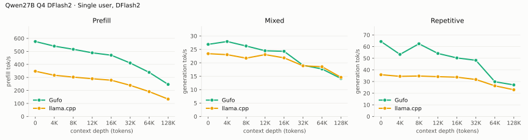

---

<!-- bench:single-dflash2-q8 -->
| Qwen27B Q8 DFlash2 Depth (tokens) | Gufo pp (tok/s) | llama.cpp pp (tok/s) | Gain pp | Gufo tg mixed (tok/s) | llama.cpp tg mixed (tok/s) | Gain mixed | Gufo tg repetitive (tok/s) | llama.cpp tg repetitive (tok/s) | Gain repetitive |
| ---: | ---: | ---: | ---: | ---: | ---: | ---: | ---: | ---: | ---: |
| 0 | 445.02 | 333.85 | +33.3% | 16.44 | 15.00 | +9.6% | 47.69 | 23.83 | +100.1% |
| 4,096 | 407.55 | 310.23 | +31.4% | 16.71 | 16.12 | +3.7% | 41.47 | 23.59 | +75.8% |
| 8,192 | 389.48 | 292.86 | +33.0% | 16.04 | 15.27 | +5.0% | 42.61 | 23.21 | +83.6% |
| 12,288 | 380.40 | 280.40 | +35.7% | 15.50 | 13.21 | +17.3% | 41.75 | 22.10 | +88.9% |
| 16,384 | 370.43 | 269.03 | +37.7% | 14.87 | 13.83 | +7.5% | 40.92 | 22.56 | +81.4% |
| 32,768 | 332.88 | 231.89 | +43.6% | 15.17 | 14.44 | +5.1% | 37.88 | 21.16 | +79.0% |
| 65,536 | 283.99 | 185.73 | +52.9% | 12.38 | 12.62 | -1.9% | 27.70 | 19.03 | +45.6% |
| 131,072 | 216.84 | 131.80 | +64.5% | 10.06 | 11.62 | -13.4% | 26.80 | 17.23 | +55.5% |
<!-- /bench -->

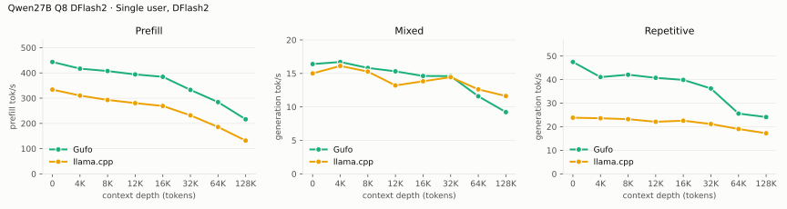

## Multiple users, autoregressive

Context 4096 per user, tg128. Throughput sums individual request decode rates,
excluding prefill and scheduling. One AR workload per concurrency.

<!-- bench:multi-ar-q4 -->
| Qwen27B Q4 AR Users | Gufo AR (tok/s) | llama.cpp AR (tok/s) | Gain |
| ---: | ---: | ---: | ---: |
| 1 | 12.42 | 12.20 | +1.8% |
| 2 | 23.83 | 22.58 | +5.5% |
| 4 | 44.27 | 38.94 | +13.7% |
| 6 | 61.02 | 47.45 | +28.6% |
| 8 | 74.95 | 50.14 | +49.5% |
<!-- /bench -->

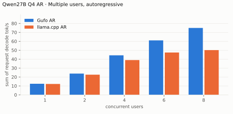

---

<!-- bench:multi-ar-q8 -->
| Qwen27B Q8 AR Users | Gufo AR (tok/s) | llama.cpp AR (tok/s) | Gain |
| ---: | ---: | ---: | ---: |
| 1 | 7.21 | 7.24 | -0.4% |
| 2 | 14.45 | 13.71 | +5.4% |
| 4 | 27.79 | 25.32 | +9.8% |
| 6 | 39.89 | 34.64 | +15.2% |
| 8 | 51.63 | 41.57 | +24.2% |
<!-- /bench -->

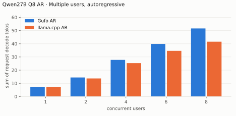

## Multiple users, DFlash2

Mixed prompts and repetitive output, context 4096 per user, up to 128 output
tokens. Rates sum individual request decode rates. No prompt-cache hits.

<!-- bench:multi-dflash2-q4 -->
| Qwen27B Q4 DFlash2 Users | Gufo mixed (tok/s) | llama.cpp mixed (tok/s) | Gain | Gufo repetitive (tok/s) | llama.cpp repetitive (tok/s) | Gain |
| ---: | ---: | ---: | ---: | ---: | ---: | ---: |
| 1 | 37.19 | 27.15 | +37.0% | 71.55 | 37.56 | +90.5% |
| 2 | 57.20 | 40.04 | +42.9% | 105.08 | 51.65 | +103.4% |
| 4 | 74.29 | 74.43 | -0.2% | 113.45 | 93.38 | +21.5% |
| 6 | 83.30 | 77.19 | +7.9% | 117.03 | 97.52 | +20.0% |
| 8 | 91.27 | 71.71 | +27.3% | 128.42 | 113.56 | +13.1% |
<!-- /bench -->

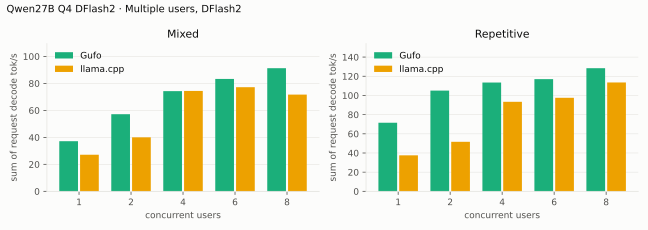

---

<!-- bench:multi-dflash2-q8 -->
| Qwen27B Q8 DFlash2 Users | Gufo mixed (tok/s) | llama.cpp mixed (tok/s) | Gain | Gufo repetitive (tok/s) | llama.cpp repetitive (tok/s) | Gain |
| ---: | ---: | ---: | ---: | ---: | ---: | ---: |
| 1 | 25.04 | 17.54 | +42.8% | 51.69 | 24.09 | +114.6% |
| 2 | 44.50 | 31.64 | +40.6% | 87.02 | 41.60 | +109.2% |
| 4 | 53.02 | 43.88 | +20.8% | 107.08 | 58.92 | +81.7% |
| 6 | 58.97 | 53.14 | +11.0% | 115.36 | 72.40 | +59.3% |
| 8 | 66.63 | 60.64 | +9.9% | 123.47 | 86.25 | +43.2% |
<!-- /bench -->

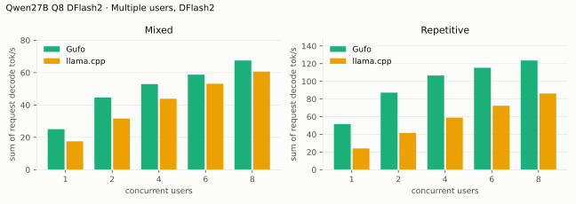

## Loading time

C1, context capacity 262144, DFlash2. Cold target/draft files to HTTP readiness.

<!-- bench:loading -->
| Qwen27B Target | Gufo ready (s) | llama.cpp ready (s) | Gain |
| --- | ---: | ---: | ---: |
| Q4 | 6.27 | 23.33 | +272.1% |
| Q8 | 8.59 | 36.47 | +324.6% |
<!-- /bench -->

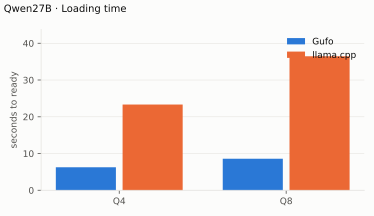

## Memory occupation

C1, context capacity 262144, AR. Peak memory reported by HIP. Main `23fd87dc`
gives the same peaks. Gufo now loads the vision projector by default, and HIP
counts retained RAM prompt snapshots: with `--cache-ram-bytes 1073741824`, Q4
peaks at 39.14 GiB in both rows.

<!-- bench:memory-q4 -->
| Qwen27B Q4 AR Workload | Gufo GiB | llama.cpp GiB | Gain |
| --- | ---: | ---: | ---: |
| pp2048 + tg128 | 40.20 | 36.19 | -10.0% |
| 16K prefix, pp4096 + tg128 | 50.27 | 36.62 | -27.2% |
<!-- /bench -->

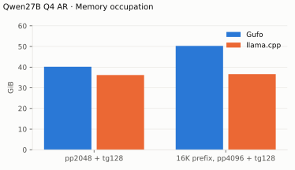

---

<!-- bench:memory-q8 -->
| Qwen27B Q8 AR Workload | Gufo GiB | llama.cpp GiB | Gain |
| --- | ---: | ---: | ---: |
| pp2048 + tg128 | 53.15 | 48.60 | -8.6% |
| 16K prefix, pp4096 + tg128 | 63.22 | 49.02 | -22.5% |
<!-- /bench -->

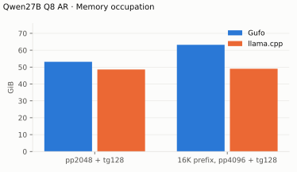
