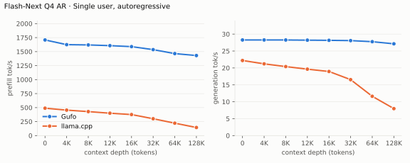
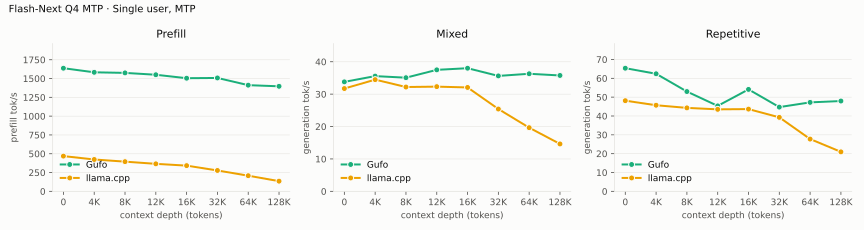
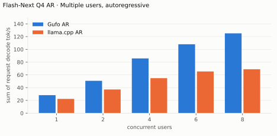

# Qwen3.8 Flash-Next benchmarks

AMD Strix Halo `gfx1151`, 128 GB unified memory. Unsloth `UD-Q4_K_XL` target and
shared-Q8_0 MTP sidecar; Gufo uses adaptive MTP. HTTP, greedy, thinking off.
Gufo measured October 16, 2026, at `fdc21849`, after merged #603 and the cache
follow-up. All six Gufo sections use the refreshed HTTP captures.
Reference results remain unchanged from September 22–23.
llama.cpp uses `b11069` for AR and `6fcaa16f` for MTP.

Positive gain favors Gufo.
[Quality and measurement details](QUALITY.md#benchmark-method) · [Model identities](artifacts/model-identities.json)

Gufo numerical regression checks pass; individual functional timing limits
remain documented in [QUALITY.md](QUALITY.md). Historical llama.cpp MTP values are retained as requested:
a separate check of that pin did not match its own AR output, so this review
does not requalify those comparisons. [Review evidence](artifacts/decode-kernels-review.json).

At 128K, AR pp improves 7.5% over post-#603 main, remaining 2.2% below the
older 1529.63 tok/s result. MTP pp is within 0.9% of the historical 64K/128K
results; 128K mixed/repetitive generation retains #603's gains.

## Single user, autoregressive

Approximately pp2048 / tg128; depth is the cached prefix in tokens.
Context capacities differ between engines; see the measurement details.

<!-- bench:single-ar -->
| Flash-Next Q4 AR Depth (tokens) | Gufo pp (tok/s) | llama.cpp pp (tok/s) | Gain | Gufo tg (tok/s) | llama.cpp tg (tok/s) | Gain |
| ---: | ---: | ---: | ---: | ---: | ---: | ---: |
| 0 | 1737.24 | 489.59 | +254.8% | 28.28 | 22.20 | +27.4% |
| 4,096 | 1673.56 | 455.24 | +267.6% | 28.28 | 21.21 | +33.3% |
| 8,192 | 1667.16 | 428.85 | +288.8% | 28.26 | 20.40 | +38.5% |
| 12,288 | 1648.13 | 400.21 | +311.8% | 28.24 | 19.64 | +43.8% |
| 16,384 | 1649.96 | 375.89 | +338.9% | 28.20 | 18.95 | +48.8% |
| 32,768 | 1624.38 | 301.31 | +439.1% | 28.05 | 16.54 | +69.6% |
| 65,536 | 1554.57 | 221.94 | +600.4% | 27.84 | 11.62 | +139.6% |
| 131,072 | 1496.49 | 144.78 | +933.6% | 27.30 | 7.98 | +242.1% |
<!-- /bench -->

## Single user, MTP

pp is the highest measured rate per engine and depth across mixed/repetitive
text, including Gufo predictor catch-up.

<!-- bench:single-mtp -->
| Flash-Next Q4 MTP Depth (tokens) | Gufo pp (tok/s) | llama.cpp pp (tok/s) | Gain pp | Gufo tg mixed (tok/s) | llama.cpp tg mixed (tok/s) | Gain mixed | Gufo tg repetitive (tok/s) | llama.cpp tg repetitive (tok/s) | Gain repetitive |
| ---: | ---: | ---: | ---: | ---: | ---: | ---: | ---: | ---: | ---: |
| 0 | 1722.87 | 468.76 | +267.5% | 35.73 | 31.73 | +12.6% | 73.45 | 48.12 | +52.6% |
| 4,096 | 1655.82 | 423.79 | +290.7% | 37.61 | 34.48 | +9.1% | 70.39 | 45.71 | +54.0% |
| 8,192 | 1652.67 | 394.98 | +318.4% | 36.82 | 32.20 | +14.3% | 58.02 | 44.31 | +30.9% |
| 12,288 | 1634.94 | 365.91 | +346.8% | 39.14 | 32.32 | +21.1% | 48.47 | 43.53 | +11.3% |
| 16,384 | 1624.24 | 341.98 | +375.0% | 40.45 | 32.07 | +26.1% | 59.88 | 43.66 | +37.2% |
| 32,768 | 1603.57 | 277.61 | +477.6% | 39.65 | 25.41 | +56.0% | 52.36 | 39.28 | +33.3% |
| 65,536 | 1547.21 | 208.04 | +643.7% | 38.68 | 19.65 | +96.8% | 52.26 | 27.75 | +88.3% |
| 131,072 | 1484.85 | 135.42 | +996.5% | 38.64 | 14.63 | +164.1% | 52.68 | 20.96 | +151.3% |
<!-- /bench -->

## Multiple users, autoregressive

Same pp2048 prose prompt as single-user d0, tg128, context 4096 per user.
All sessions prefilled before timed decoding; throughput sums individual rates.
llama.cpp re-evaluates its four-token checkpoint tail.

<!-- bench:multi-ar -->
| Flash-Next Q4 AR Users | Gufo AR (tok/s) | llama.cpp AR (tok/s) | Gain |
| ---: | ---: | ---: | ---: |
| 1 | 28.22 | 22.34 | +26.3% |
| 2 | 50.67 | 37.08 | +36.7% |
| 4 | 85.78 | 54.82 | +56.5% |
| 6 | 107.98 | 65.34 | +65.3% |
| 8 | 125.14 | 68.79 | +81.9% |
<!-- /bench -->

## Multiple users, MTP

Same pp2048 mixed/repetitive prompts as single-user d0, tg128, context 4096
per user. All sessions prefilled before timed decoding; rates sum individual
request decode rates. C1 cross-checks the single-user table.

<!-- bench:multi-mtp -->
| Flash-Next Q4 MTP Users | Gufo mixed (tok/s) | llama.cpp mixed (tok/s) | Gain | Gufo repetitive (tok/s) | llama.cpp repetitive (tok/s) | Gain |
| ---: | ---: | ---: | ---: | ---: | ---: | ---: |
| 1 | 35.62 | 31.77 | +12.1% | 73.19 | 46.93 | +56.0% |
| 2 | 59.65 | 42.79 | +39.4% | 97.43 | 52.57 | +85.3% |
| 4 | 86.53 | 48.78 | +77.4% | 157.58 | 48.23 | +226.7% |
| 6 | 108.66 | 52.59 | +106.6% | 176.47 | 48.51 | +263.8% |
| 8 | 125.42 | 61.92 | +102.6% | 194.37 | 58.13 | +234.4% |
<!-- /bench -->

## Loading time

C1, context capacity 262144, MTP. Cold target/sidecar files to HTTP readiness.

<!-- bench:loading -->
| Flash-Next Q4 Target | Gufo ready (s) | llama.cpp ready (s) | Gain |
| --- | ---: | ---: | ---: |
| Q4 | 15.27 | 117.83 | +671.6% |
<!-- /bench -->

## Memory occupation

C1, context capacity 133121, AR. Peak memory reported by HIP.

<!-- bench:memory -->
| Flash-Next Q4 AR Workload | Gufo GiB | llama.cpp GiB | Gain |
| --- | ---: | ---: | ---: |
| pp2048 + tg128 | 88.75 | 84.84 | -4.4% |
| 16K prefix, pp4096 + tg128 | 90.73 | 85.31 | -6.0% |
<!-- /bench -->

